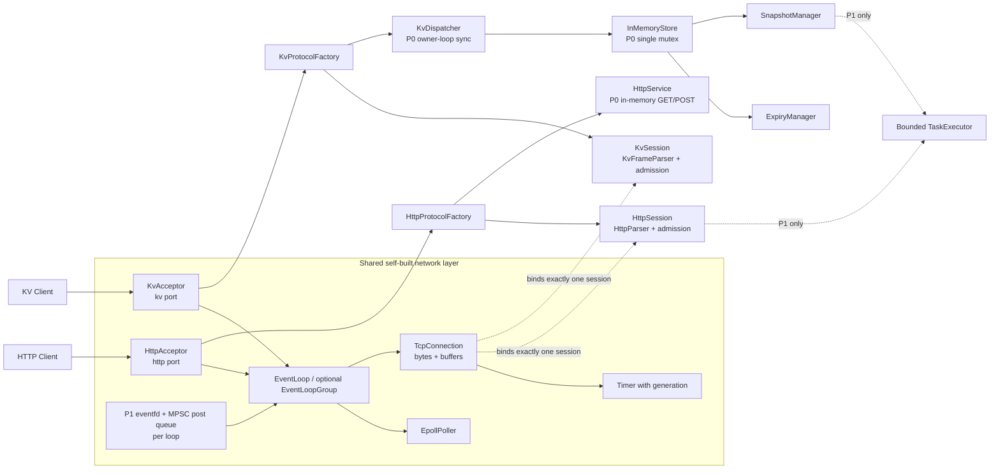
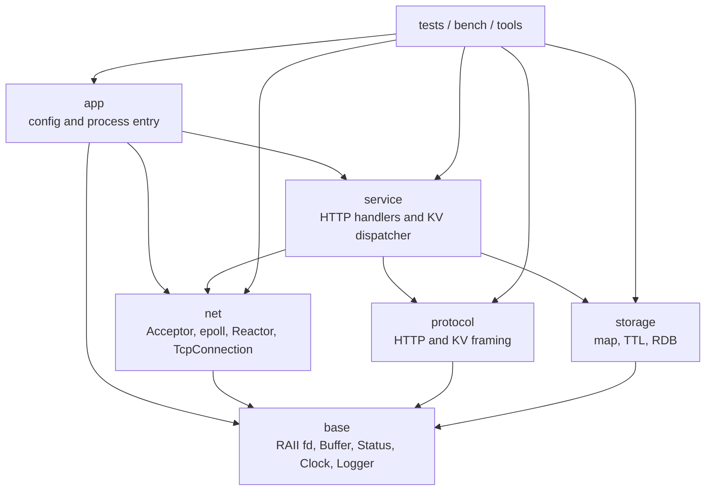
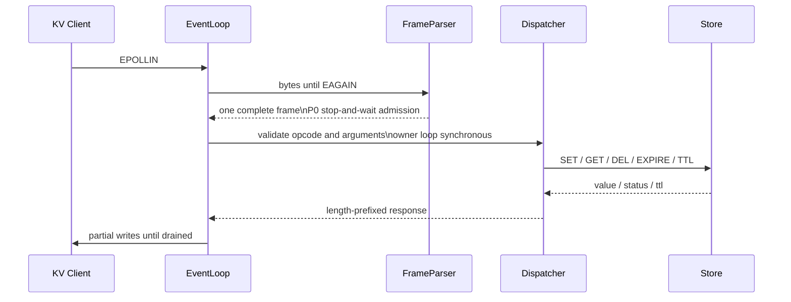

# MiniDB 项目实施计划书

> 文档状态：`Draft / 持续更新`
>
> 当前基线：仓库为空，尚未有源码、构建配置、测试、性能数据或 Git 历史。下面的“完成”均指通过对应验收门槛，不指代码已经写出。
>
> 推进方式：按技术依赖和验收结果推进，不设置项目总工期、周计划或强制截止日期。每个里程碑完成后更新本文件的状态、证据链接、已知问题和下一步准入条件。

## 使用方式和当前假设

这份计划书是 MiniDB 的长期设计、学习和验收基线。每次实现一个任务时，同时更新四类记录：

1. 代码和测试入口；
2. 设计决策记录（为什么这样做、考虑过什么替代方案）；
3. 验收证据（测试命令、日志、报告或复现脚本）；
4. 尚未解决的问题和对计划的调整。

必要假设如下：

- 物理主机是 Windows；主要开发和验收环境假设为 WSL2 Ubuntu 22.04/24.04、GCC 12+ 或 Clang 15+。编译、运行、测试和 Linux 工具都在 WSL2 内执行。WSL2 中运行的是 Linux kernel，可用于 epoll 的功能和正确性验收；它不是裸机 Linux 性能环境。
- WSL2 中的项目工作副本建议放在 Linux 文件系统，例如 `~/projects/miniDB`，不要把长期构建目录放在 `/mnt/e/...`。跨 Windows 挂载目录会影响文件权限/元数据、文件监控和构建 I/O，性能结果也更难解释。可用 VS Code Remote - WSL 或其他 WSL-aware 编辑器打开 Linux 路径。
- 若不能安装或启用 WSL2，原生 Windows 可继续完成 C++/CMake、协议解析、Store、TTL 和部分单元测试；Socket/epoll/Reactor 阶段必须等到可用的 Linux 环境（WSL2、远程 Linux 主机或云 VM）再验收。不要用 Winsock/IOCP 冒充 Linux epoll 实现。
- 采用 C++20、CMake、CTest 和 GoogleTest。若目标环境不支持 C++20，退回 C++17，并记录因标准差异做出的替代实现。
- 初版网络层只支持 Linux epoll；不以跨平台为 P0 目标。Windows 原生构建可作为可移植模块的补充检查，不要求网络核心支持 Windows。
- HTTP 只实现文档明确列出的子集，不宣称完整 HTTP/1.1 兼容。
- KV 服务是单机、单进程服务；不实现 Raft、复制、事务、集群和生产级 Redis 兼容性。
- 当前没有性能基线，所有 QPS、延迟、并发上限和快照耗时都使用占位符，完成基准测试后再填写。

### Windows 主机环境准备

1. 在 Windows 检查版本、硬件虚拟化和组织策略；PowerShell 执行 `wsl --status`、`wsl --list --verbose`，确认发行版的 VERSION 为 `2`。若尚未安装且设备策略允许，按 Microsoft WSL 文档安装 Ubuntu 22.04/24.04，并在发行版内创建 Linux 用户。
2. 在 Ubuntu 中安装 `build-essential`、`cmake`、`ninja-build`、`gdb`、`strace`、`git`、`pkg-config` 和需要的 sanitizer 工具；GoogleTest 优先使用固定版本的 CMake FetchContent 或固定发行包，并记录来源。用 `CMakePresets.json` 统一 Debug、Release、ASan/UBSan 和 TSan 配置。
3. 将整个项目工作副本放在 WSL 的 Linux 文件系统 `~/projects/miniDB`。当前 Windows 路径 `E:\c++\miniDB` 只作为迁移前的文档位置；开始实现前把整个项目迁入 WSL，以 WSL 副本作为唯一可写 Git 工作树，不要在 E: 和 WSL 各维护一份仓库，也不要在 `/mnt/e` 进行主构建、测试或基准。
4. 先在 WSL 中验证 `uname -a`、`g++ --version`、`cmake --version`、CTest 和一个最小 Socket 程序，再进入阶段 A。分别 smoke test ASan/UBSan、TSan 和 perf；TSan/perf 能否正常工作取决于 WSL kernel 与权限，记录 WSL 版本、Ubuntu 版本、WSL kernel 和 Windows 版本。
5. Docker Desktop 不是必需前置条件。WSL2 内的容器支持或 Docker Desktop 可用于演示，但不代替直接在 WSL Linux 用户空间运行 epoll 测试。

如果电脑策略、硬件或 Windows 版本禁止启用 WSL2，先完成与平台无关的 RAII、Buffer、parser、Store、TTL、RDB 和单元测试；Linux Socket/epoll 阶段暂停，直到有远程 Linux 主机或云 VM。原生 Windows 的 Winsock、IOCP、线程池和事件机制不能改名映射成该阶段产物，也不在核心代码维护第二套 `_WIN32` Reactor。若没有 Linux 执行环境，不能把原生 Windows 测试标成 Linux 阶段通过。

---

## 第 1 章 项目概述

### 1.1 项目定位

MiniDB 是一个用 C++ 实现的网络通信与单机 KV 存储服务。它由两个可独立运行、共享通用网络基础设施的服务组成：

- HTTP 服务：用于学习非阻塞 Socket、epoll、Reactor、连接生命周期、HTTP 增量解析和并发请求处理；
- KV 服务：用于学习二进制协议、哈希表、并发读写、TTL、快照持久化和启动恢复。

核心网络机制由项目自主实现：非阻塞 Socket、单 EventLoop/可选 EventLoopGroup、epoll、连接读写缓冲区和连接状态管理；有界线程池在核心 P0 稳定后作为 P1 实现。可以使用标准库、CMake、GoogleTest、CTest、Sanitizer、日志库和压测工具等辅助设施，但不得用 muduo、Boost.Asio 等成熟网络库替代学习目标。

### 1.2 技术目标

完成后应能清楚解释并用测试证明以下问题：

- 一个非阻塞 fd 如何处理 `EINTR`、`EAGAIN`、半关闭、部分读写和 `EPOLLHUP/EPOLLERR`；
- Reactor 如何分配事件，为什么一个连接只能由一个 owner EventLoop 线程访问；
- 线程池如何处理任务生命周期、队列满、停止和异常；
- HTTP 和自定义 KV 协议如何在任意字节边界下增量解析；
- TTL 如何在并发读写、边界时间和恢复后保持一致语义；
- RDB 如何保证损坏文件不污染已有数据，并能复现恢复结果；
- 如何用测试、sanitizer、strace、gdb、perf 和基准数据证明实现的边界。

### 1.3 求职价值和已有 AI 项目的互补关系

已有 AI 项目体现了 Python 应用层、模型调用、RAG、Agent、服务编排和全栈交付能力。MiniDB 补充的是另一层能力：C++ 资源管理、Linux 系统调用、网络事件驱动、并发正确性、数据持久化和性能证据。两类项目合起来，可以展示从模型应用到服务底层的完整工程视角。

面试展示重点应放在“问题、实验、证据、取舍”上，例如：为什么先用 LT epoll，怎样证明读到 `EAGAIN`，为什么线程池不能直接操作连接 fd，RDB 损坏时如何避免加载半份数据，以及优化前后数据如何复现。

### 1.4 最终交付成果

- 可重复构建的 C++20/CMake 工程；
- 自研网络层、HTTP 子集服务和 KV 服务；
- 单元、集成、异常、并发、恢复和性能测试；
- Sanitizer、调试和性能分析记录；
- README、架构图、协议说明、设计决策记录和复盘文档；
- Docker 运行方式和可重复演示脚本；
- 至少一次真实开源贡献尝试记录（PR 是否合并不作为核心完成门槛）；
- 简历和面试材料中使用实测数据，未完成项保留占位符。

---

## 第 2 章 功能范围与优先级

优先级含义：P0 是核心功能和正确性所必需；P1 显著改善可靠性、工程质量或技术深度；P2 是核心稳定后的进阶扩展。P1/P2 不能抢占尚未通过的 P0 验收。

### 2.1 范围表

| 模块 | 功能 | 优先级 | 前置条件 | 验收摘要 |
|---|---|---:|---|---|
| 工程 | CMake、Debug/Release、警告、CTest、基础日志、配置 | P0 | 无 | 干净环境可配置、编译、测试 |
| 工程 | RAII fd/socket、错误类型、统一资源释放 | P0 | C++ 生命周期、异常安全 | 失败路径和 fd 复用无泄漏 |
| 网络 | blocking/non-blocking Socket 实验 | P0 | WSL2/远程 Linux、Linux syscall 基础 | 可解释 `EINTR/EAGAIN`，异常断开可复现 |
| 网络 | LT epoll、Acceptor、EventLoop、Channel、TcpConnection | P0 | Socket 实验 | 多连接、部分读写、HUP/ERR、无 UAF |
| 网络 | 读写缓冲、Keep-Alive、半关闭、空闲超时 | P0 | TcpConnection | 跨包、跨读、写到 `EAGAIN` 后恢复 |
| 网络 | 单 EventLoop、owner loop 和 loop-local dispatch | P0 | 单线程 Reactor | 无跨线程 fd 访问，关闭可回收 |
| 并发 | 多 EventLoop、fd 交接、每 loop eventfd/post queue | P1 | 单 EventLoop 通过 | 交接失败可回收，post/stop 竞态可解释 |
| 并发 | 有界任务队列和线程池 | P1 | owner loop 和背压规则 | 队列满有明确定义，停止不丢资源 |
| 网络 | ET 或 `EPOLLONESHOT` | P1 | P0 LT 全部通过 | 以同一测试矩阵比较复杂度和收益 |
| HTTP | request line、header、Content-Length body 增量解析 | P0 | Reactor、Buffer | 一字节碎片和恶意限额测试通过 |
| HTTP | 内存 GET、POST、Keep-Alive（响应完成后才读取下一请求）；200/400/404/405/408/413/414/417/431/500/501/505 | P0 | HTTP parser | 单连接一个 in-flight、无 pipelining、状态/Allow/关闭语义符合协议文档 |
| HTTP | 过载 503 和异步 completion | P1 | executor/admission backpressure | 不越过同连接前序响应，错误响应关闭策略通过 |
| HTTP | 安全静态文件访问 | P1 | P0 HTTP 通过；root fd/openat 方案 | symlink、TOCTOU、权限和大小限制测试通过 |
| HTTP | TLS、Range、完整 RFC 兼容 | P2/舍弃 | 需要大幅扩展范围 | 不实现，不在 README 中宣称支持 |
| HTTP | Transfer-Encoding、Upgrade | P0 明确拒绝 | parser message-boundary validation | 返回规定错误并关闭，绝不误解析 body |
| KV | 长度前缀二进制帧、opcode/参数、最大帧限制 | P0 | Buffer、协议设计 | 粘包、拆包、坏长度安全拒绝；单连接 stop-and-wait |
| KV | SET、GET、DEL、PING、SAVE | P0 | 协议 parser、Store/RDB | 单元和端到端结果正确；SAVE 成功仅在文件和父目录同步成功后返回 |
| KV | EXPIRE、TTL、惰性删除、定期扫描 | P0 | Store、时钟抽象 | `-2/-1` 语义和边界时间正确 |
| KV | `unordered_map`、单 `std::mutex`、owner-loop 同步命令 | P0 | KV Session、锁协议 | TSan/长压测无数据竞争和死锁 |
| KV | `shared_mutex` 对照和 KV 专属 executor | P1 | P0 正确性和基准证据 | 只有测出收益后实现并比较 |
| 持久化 | RDB magic/version/count/长度/过期时间/checksum | P0 | Store、二进制编码 | 截断、篡改、版本错误安全失败 |
| 持久化 | 停顿服务的一致性快照、临时文件、fsync、原子 rename、恢复 | P0 | RDB 格式 | 重启恢复值和 TTL，旧文件不被坏文件覆盖 |
| 持久化 | 复制一致性视图、解锁后线程池写盘 | P1 | P0 快照和实测停顿数据 | mutation admission 暂停时间显著降低，语义和性能有数据证明 |
| 存储优化 | copy-on-write 快照、增量日志、LRU、压缩 | P2 | P0 性能和正确性 | 仅基于实测瓶颈立项 |
| QA | GoogleTest/CTest、ASan、UBSan、TSan、集成脚本 | P0 | 工程基线 | 结果可重复，已知例外有记录 |
| 性能 | HTTP/KV 基准、原始数据、环境和脚本 | P1 | 服务稳定 | 不虚构结果，报告含 P50/P95/P99 或缺失说明 |
| 工程 | Docker、CI、README、协议文档、架构图 | P1 | 工程基线 | 新环境按文档运行 |
| 开源 | 外部仓库 issue、测试改进或小型修复 | P1 | 基本 Git 能力 | 有公开链接、讨论和结果记录；是否合并不阻塞 MiniDB |

### 2.2 应主动推迟或舍弃的内容

在 P0 通过前推迟多 EventLoop、线程池 offload、ET、`EPOLLONESHOT`、零拷贝、io_uring、协程、无锁结构、LRU、压缩、写时复制快照和完整 HTTP 兼容。静态文件、`shared_mutex` 和异步快照也必须等到对应安全性或性能证据出现。它们会增加状态空间，不能替代对基本事件循环和资源生命周期的理解。

P2 对照实现可以选择 Boost.Asio 写一个小型 Echo 或 KV 对照服务，比较代码量、抽象层次、可测试性和实测性能；它不进入自研网络层的核心验收。

---

## 第 3 章 总体架构设计

### 3.1 系统架构图



### 3.2 模块依赖图



图中箭头统一表示“左侧模块依赖右侧模块”。边界规则：`base` 不知道业务；`net` 只处理字节、连接、epoll 和定时器，不依赖或猜测 `protocol`；`protocol` 只定义 HTTP/KV 编解码，不访问网络或存储；`Session/service` 同时依赖 `net` 与 `protocol`，负责 admission、协议错误、业务语义和响应映射；`storage` 不依赖网络。HTTP 与 KV 使用独立 listener/端口和 `ProtocolFactory`，只共享 `EventLoop`、`TcpConnection`、Buffer 和 Timer；P1 才共享 per-loop post/wakeup 机制，不共享 parser、错误码、命令语义或业务状态。

### 3.3 线程和连接生命周期

P0 先使用单 EventLoop，HTTP 和 KV 各自由独立 listener 接入；每个连接有唯一 owner loop，连接 fd、Channel、parser、Session、读写缓冲和状态只由 owner loop 线程访问。先将完整请求转成拥有数据的请求对象，在 owner loop 同步执行短命令；只有基准证明业务会阻塞后，才在 P1 引入专属 executor。P0 每条连接只允许一个已解析/执行中的请求，不建立请求队列，也不并发处理同一连接上的请求。请求完整后处理或响应未写完期间禁用该连接的 EPOLLIN；如果同一次底层 read 已带入后续字节，它们只能作为有界、未解析的原始输入保留，不得构造下一请求。响应完全写出后才重新启用读取并解析下一请求。P0 不提供 HTTP pipelining；连接和内核背压仍受资源上限约束。

P1 多 EventLoop 时，Acceptor 暂停新 fd 的处理并将 fd 交给 worker；在 worker 确认 `epoll_ctl(ADD)` 成功前，fd 的唯一 owner 仍是 Acceptor，transfer 失败由 Acceptor 关闭，成功确认后才转移给 worker。每个 loop 持有独立 `eventfd(EFD_NONBLOCK|EFD_CLOEXEC)` 和有界 MPSC post queue，按条目数和 owning payload 字节数双重限额。post 入队成功即接受一次 FIFO 工作项；重复调用代表不同工作项，调用方不得在成功后重试。队列关闭后拒绝所有新 post，但按 stop 策略 drain 已接受项；队列满时非 completion post 返回失败且不阻塞。executor 接受任务前须预留 completion 容量，确保每个已接受任务都能发布一次 completion。生产者先入队再写 eventfd，owner loop 读空 eventfd 后 drain 队列；eventfd 写返回 EINTR 时重试，EAGAIN 视为已有唤醒待处理。loop stop 后拒绝新 post，迟到 completion 通过 `ConnectionToken{id,generation,request_sequence,weak_state}` 校验后丢弃。跨线程只传 owning request/response，不传 `string_view`、Buffer view、raw connection pointer 或延长 `TcpConnection` 生命周期的 `shared_ptr`。队列满时按请求顺序返回 HTTP 503 或 KV BUSY；不能越过前序响应回写错误。

连接状态：

```text
Accepted -> Reading -> Processing -> Writing
    |          |            |           |
    +----------+------------+-----------+--> Draining -> Closed
    |          |            |           +--> fatalClose -> Closed
```

协议错误、header/body 超限、超时和可报告业务错误进入 `Draining`：停止读取新请求，生成错误响应，写到 EAGAIN 后关闭；若响应无法安全构造或 output 预算不足则 `fatalClose`。事件处理先读取 `EPOLLERR` 对应的 `SO_ERROR`；非零 socket error 立即 `fatalClose`。无 socket error 时，HUP/RDHUP 与 EPOLLIN 一起处理：先读到 EAGAIN 或 EOF，再处理已完整收到的请求；EOF/RDHUP 后停止新读取，允许已接受响应 drain。write/send 遇 EPIPE/ECONNRESET 立即 `fatalClose`，不再生成响应。P0 进程统一忽略 SIGPIPE，所有写失败通过 errno 处理；阶段 C 验证 EPIPE 不终止进程。fd 交接失败和资源破坏由当前 owner 从 epoll 删除、取消 timer、关闭 fd。P0 的 `epoll_ctl` 失败，以及 P1 的 eventfd/线程创建失败，都必须有明确 owner 和回收策略；EMFILE/ENFILE 时暂停 listener 并用有界退避 timer 恢复 accept，已有连接继续服务。P0 用 `signalfd` 接收已屏蔽的 SIGINT/SIGTERM 并在 EventLoop 上触发一次 stop。

统一 shutdown 顺序为：收到一次 stop -> Acceptor 停止 accept -> owner loop 停止读取新请求和 admission、完成当前同步回调并 drain 已接受的 P1 任务 -> executor 禁止新任务并 drain/cancel、join -> owner loop 应用或丢弃 tokenized completion；被取消的 mutation 不得返回成功 -> 停止、唤醒并 join scanner -> 在服务仍存活且不再处理命令时按配置执行 SAVE barrier -> owner loop 在有界宽限期内 drain 已排队响应，然后关闭连接 fd -> 销毁 Store/service/config -> 关闭 signalfd/eventfd/epoll。SAVE 使用父目录 fd 创建同目录临时文件，依次 write-all、文件 fsync、close、原子 rename、父目录 fsync；rename 前任一步失败保留旧快照并返回错误，清理临时文件且记录清理失败；rename 后父目录 fsync 失败返回 `DURABILITY_UNCONFIRMED`，新路径可能已可见，在线服务可继续但关停 SAVE 以非零状态退出。父目录 fsync 成功后目录 fd close 失败只记录资源错误，不撤销已确认的持久性。重复 stop 必须幂等；正常退出是否保存由显式配置决定，崩溃退出不承诺自动保存。

### 3.4 HTTP 请求处理流程

```mermaid
sequenceDiagram
  participant C as Client
  participant E as Owner EventLoop
  participant T as TcpConnection
  participant H as HttpSession and Parser
  participant R as HttpService
  participant X as P1 Executor
  C->>E: EPOLLIN
  E->>T: read until EAGAIN
  T->>H: feed arbitrary byte chunks
  H-->>E: NeedMore / one Complete / Error
  alt P0 synchronous
    E->>R: owning request, one in-flight
    R-->>E: response data
  else P1 offload
    E->>X: owning request + ConnectionToken
    X->>R: execute handler
    R-->>X: owning response
    X->>E: post completion via eventfd
    E->>E: validate token and sequence
  end
  E->>T: encode response and enable EPOLLOUT
  T->>E: enable EPOLLOUT
  E->>T: write until EAGAIN
  T-->>C: response
  T->>E: keep-alive -> next serialized request; close -> Draining/fatalClose
```

HTTP P0 支持矩阵必须写入 `docs/protocol-http.md`：仅 HTTP/1.1、origin-form、恰好一个非空且语法合法的 `Host`、header 名大小写不敏感并拒绝 obs-fold、有限 header 数量/总字节数、可选 `Content-Length` body、GET/POST 和内存路由；至少定义 GET-only `/health` 与 POST-only `/echo`，以固定 405 的 `Allow` 行为；absolute-form、authority-form、asterisk-form 均返回 400。只接受十进制非负 `Content-Length`，数值一致的重复值可接受；CL+TE 返回 400 并关闭；任何 `Transfer-Encoding` 返回 501 并关闭；`Expect` 返回 417 并关闭；`Upgrade` 返回 400 并关闭；超大 request-target/header/body 分别返回 414/431/413 后关闭；不支持版本返回 505。方法 token 语法非法返回 400；语法合法但服务不识别/不实现的方法返回 501；对 `/health` 使用 POST、对 `/echo` 使用 GET 返回 405，`Allow` 分别准确为 `GET` 和 `POST`。P0 GET 禁止非空 body，返回 400 并关闭；POST 缺省 Content-Length 视为零长度。`Connection` token 大小写不敏感；无 `close` token 时 Keep-Alive 默认启用，收到 `close` 时该响应带 `Connection: close` 并在写完后关闭。请求解析超时返回 408 后关闭。P0 每连接至多一个已解析/执行中的请求；处理当前请求或写响应期间禁用 EPOLLIN，响应完全写出后才重新启用读取并解析下一请求，不积累待处理请求对象，也不支持 HTTP pipelining。若同一次底层 read 已带入后续字节，仅以有界、未解析原始输入保存，不能构造请求队列。关闭连接过程中无法再发送的错误不承诺响应；P0 不实现 executor 队列过载，不需要 503。静态文件属于 P1；若实现，使用 root fd 和逐路径组件 `openat`（目录组件 `O_DIRECTORY|O_NOFOLLOW`，末端 `O_NOFOLLOW|O_CLOEXEC`），再 `fstat` 检查普通文件、权限和大小；若 Linux 环境支持，可评估 `openat2(RESOLVE_BENEATH|RESOLVE_NO_SYMLINKS)`，并覆盖 symlink/替换文件/TOCTOU 测试。项目不宣称完整 HTTP/1.1 兼容。

P0 默认限额起点（全部可配置，修改需记录内存预算和边界测试）：单连接 HTTP request-line 4 KiB、header 总量 16 KiB/最多 64 个字段、body 1 MiB、输入缓冲不超过 1.1 MiB、output 1 MiB；KV 单 frame 1 MiB、key 1 KiB，value 受 frame 上限约束；最多 32 个客户端连接。RDB 默认文件上限 64 MiB、记录数 100,000、key 1 KiB、value 1 MiB、运行/恢复 Store 各自受 256 MiB 实际分配预算约束。初始进程 RSS 预算设为 512 MiB，在线 SAVE 还要计入最多 64 MiB 的编码缓冲；这些是保守待测起点，不是保证值。实现前要分别估算连接 input/output、连接对象、运行 Store、恢复临时 Store、快照编码缓冲、scanner/线程和容器分配开销；启动恢复与在线 SAVE 的峰值分别计算。最大配置实测 RSS 超预算时，先降低客户端数、RDB 文件/Store 上限或单连接缓冲限额，再调整配置和文档中的预算。达到全局连接上限时新 accept 连接立即关闭并限速记录，不允许为错误响应突破输出预算。

### 3.5 KV 请求处理流程



建议帧格式：网络字节序 `uint32 frame_length`，后接版本或 opcode、参数个数、字段长度和值。所有长度都有上限，整数溢出、长度不一致、未知 opcode 和多余字节都有明确错误响应。不要用字符串 `split` 代替二进制分帧。

### 3.6 关键设计决策和替代方案

| 决策 | 原因 | 替代方案 | 何时重新评估 |
|---|---|---|---|
| 先用 LT epoll | 状态少，便于验证读写至 `EAGAIN` 和生命周期 | ET/`EPOLLONESHOT` | P0 稳定后用相同负载比较 |
| 连接单 owner loop | 避免 fd 状态跨线程竞争，简化关闭 | 多线程共享连接 | 只有明确测量出瓶颈且能补齐同步证明时 |
| 有界任务队列 | 避免无界内存增长，能观察背压 | 无界队列、直接新建线程 | 仅凭数据证明队列策略需要改变时 |
| `unordered_map` + 单 `std::mutex` | 先建立可证明的线性化点和 TTL 语义 | `shared_mutex`、分片锁 | P0 正确性后按锁竞争基准评估 |
| RDB 先写临时文件再原子替换 | 坏快照不覆盖旧快照 | 直接覆盖、WAL | 需要更短恢复窗口时评估 WAL |
| wall-clock 保存过期时间 | 重启后能判断实际剩余 TTL | 直接保存 steady clock | 解释系统时钟跳变并完成测试后再调整 |

第三方库引入规则：标准库、CMake、GoogleTest、CTest、fmt/spdlog（若确有日志需求）、wrk/hey/自写客户端、strace、gdb、perf、ASan/UBSan/TSan 可作为辅助。Linux 工具和系统调用实验在 WSL2 Ubuntu 内运行；strace/gdb 可提供系统调用和调试证据。若 WSL kernel 或权限不支持某项 perf/TSan 能力，记录具体限制并在远程 Linux/CI 补测，不能默认为已通过。任何新增库必须在 `docs/dependencies.md` 记录解决的问题、许可证、对核心学习目标的影响、替代方案和是否值得引入；网络核心库不能替代自研机制。

---

## 第 4 章 技术路线与原理学习

每项技术都按“原理 → 实验 → 正式实现 → 自证”推进。实验输出应提交到 `experiments/` 或 `docs/experiments/`，不要只看教程。

### 4.1 C++ 工程、RAII 和资源管理

- 核心原理：对象生命周期、值类别、移动语义、异常安全、所有权、析构顺序、线程安全边界；fd 不是普通整数，必须由明确 owner 管理。
- 项目需要它：网络错误路径密集，连接关闭、epoll 注销、线程退出和文件替换都容易泄漏或 double close。
- 前置知识：类、引用、模板基础、标准容器、智能指针、mutex/CV、编译链接。
- 最小实验：实现 move-only `UniqueFd`；测试移动、提前返回、异常和 fd 复用。Linux 下 `close()` 遇到 `EINTR` 不盲目重试同一数值 fd；可重试的 `EINTR` 覆盖 accept/read/write/epoll_wait 等 syscall。
- 过渡步骤：先用于独立 Socket/文件实验，再进入 `TcpConnection`、RDB writer 和线程池 worker。
- 理解标准：能画出每个 fd/连接/任务的 owner；ASan/UBSan 和人工 fd 计数在故意异常路径下无泄漏。

### 4.2 Socket 和非阻塞 I/O

- 核心原理：TCP 是字节流，不保留消息边界；`accept/read/write` 可能部分完成；`EINTR` 可重试，非阻塞 `EAGAIN/EWOULDBLOCK` 表示当前没有更多进展，不是连接错误；EOF 表示对端发送方向关闭。
- 项目需要它：HTTP 和 KV 都必须跨多次 read/write 正确处理消息。
- 前置知识：进程、fd、字节序、TCP 状态、errno。
- 最小实验：在 WSL2 Ubuntu 中实现 blocking echo、non-blocking echo、慢客户端、半关闭、故意小发送缓冲；用 Linux `nc`、`strace` 和自写客户端观察系统调用。
- 过渡步骤：抽取 `Socket`/`Acceptor`，加入 RAII，再接入事件循环。
- 理解标准：能逐次解释一段 syscall trace；测试能稳定制造部分读写、`EAGAIN` 和异常断开。

### 4.3 epoll 和 Reactor

- 核心原理：epoll interest list、ready list、LT/ET、事件掩码、fd 生命周期和回调重入；事件循环负责等待和分发，不负责业务语义。
- 项目需要它：在一个线程中管理大量连接，并将 I/O 就绪与协议处理解耦。
- 前置知识：非阻塞 fd、函数对象、状态机、线程归属。
- 最小实验：在 WSL2 Linux kernel 中只用一个监听 fd 和多个客户端，分别实现 LT 读到 `EAGAIN`；记录未读数据时 LT 的重复通知，解释 ET 漏读风险。Windows 原生 `select`、IOCP 或 WSLg 不作为这项实验的替代。
- 过渡步骤：`EpollPoller` → `Channel` → `EventLoop` → `TcpConnection` → Echo。
- 理解标准：能说明每次 add/mod/del 的时机，能用 fd 重用和 HUP 测试证明不会回调已释放对象。

### 4.4 Reactor、线程模型和线程池

- 核心原理：Reactor 只分发就绪事件；连接状态由 owner loop 串行修改；线程池处理可隔离的 CPU/磁盘任务；任务队列需要停止、背压、异常传播和生命周期协议。
- 项目需要它：P0 刻意让短业务在 owner loop 同步执行，并接受 SAVE barrier 暂停写入的成本；只有基准证明 KV/HTTP 业务阻塞明显后，P1 才用 executor 隔离可取消、拥有输入的任务。跨线程不能直接写 fd。
- 前置知识：mutex、`condition_variable`、原子变量、可见性、死锁条件、线程 join。
- 最小实验：单线程 Reactor 稳定后，用 `eventfd(EFD_NONBLOCK|EFD_CLOEXEC)` 配 MPSC 队列测试先入队再唤醒、读空后 drain、重复唤醒、EAGAIN、stop 后 post；再做有界 executor 的拒绝、worker 抛异常和 stop/join 实验。以上属于 P1，不改变 P0 的单 loop owner 规则。
- 过渡步骤：先完成并验收单 EventLoop；进入 P1 后先完成 post queue/eventfd 和有界 executor，再按单 loop 基准决定是否增加 EventLoopGroup/fd transfer。
- 理解标准：能写出 owner-loop 和 fd-transfer 不变量；TSan 并发测试无数据竞争；post/stop、队列满、线程退出和迟到 completion 都有可复现结果。

### 4.5 HTTP 解析

- 核心原理：请求行、header、空行和 body 是增量状态机；字节流可在任意位置切分；`Content-Length` 必须防整数溢出和超限；连接复用依赖请求边界清晰。
- 项目需要它：把网络 I/O 与 HTTP 语义分离，并显式限制支持范围。
- 前置知识：状态机、字符串视图、CRLF、大小写不敏感 header、路径规范化。
- 最小实验：逐字节喂入合法请求、缺 CRLF、重复/冲突 Content-Length、CL+TE、超限 target/header/body、Expect/Upgrade 和两个请求连续到达的样例。
- 过渡步骤：先冻结 `docs/protocol-http.md` 支持矩阵，再做 parser/encoder 单测和内存 GET/POST；之后实现 Keep-Alive 串行处理。静态文件另列 P1。
- 理解标准：能指出每个输入最终状态、错误响应是否 drain 后关闭；能解释为何 P0 每连接只保留一个 in-flight 请求、响应写完前不再读取后续请求，并明确不支持 HTTP pipelining/chunked；不把“能被 curl 访问”当作完整兼容。

### 4.6 哈希表、互斥锁和并发存储

- 核心原理：`unordered_map` 的桶、rehash、迭代器失效；P0 单 `std::mutex` 保护 map、Entry 和过期删除形成线性化点。`shared_mutex` 会增加锁升级与过期 Entry 生命周期问题，仅作为 P1 对照。
- 项目需要它：KV 服务要定义并发读写的线性化点和数据可见性。
- 前置知识：对象生命周期、锁、内存可见性、竞态与死锁。
- 最小实验：多个 reader、writer、deleter 操作小 map；先用单 mutex 与 fake clock 验证语义，再单独比较 `shared_mutex`，用 TSan 找数据竞争并记录锁竞争和延迟。
- 过渡步骤：P0 所有读写命令、惰性删除和 scanner 共用 Store 锁；只有基准显示锁竞争显著才做 P1 对照。若 shared lock 下发现过期 Entry，升级独占锁后必须重查 deadline/generation 再删。
- 理解标准：能说明每个命令在哪个锁区间内线性化，TTL 过期删除和 GET 结果一致；能解释 shared_mutex 的 ABA 风险。

### 4.7 TTL 和过期策略

- 核心原理：过期时间使用 wall-clock Unix ms 持久化；命令和 scanner 在同一锁协议下判定 deadline。GET/TTL 等访问触发惰性删除，scanner 提供最终清理；读取过期键必须原子地视为不存在。墙钟回拨/跳跃可能改变存活时长，必须记录其语义。
- 项目需要它：TTL 是 KV 语义和持久化恢复的交叉点。
- 前置知识：时间点/时长、时钟跳变、并发锁、后台线程退出。
- 最小实验：注入 fake clock，按表测试 SET 覆盖、EXPIRE 对缺失/已过期/0/负值/重复设置、TTL 取整、DEL、deadline 前/恰好/之后、同 key 命令与 scanner 交错、重启恢复。
- 过渡步骤：先实现惰性删除和可控扫描周期，再接入 RDB 恢复。
- 理解标准：P0 定义 `EXPIRE key ttl_ms`；SET 覆盖值并清除 TTL；EXPIRE 对缺失/已过期 key 返回 0，对存在 key 的正 ttl_ms 设置新 deadline 并返回 1，非正 ttl_ms 立即删除并在原 key 存在时返回 1；重复 EXPIRE 覆盖原 deadline；DEL 对逻辑过期 key 返回 0；TTL 返回 `-2` 表示缺失/过期、`-1` 表示无过期时间，其他值为向下取整的剩余毫秒。到期条件为 `now >= deadline`。系统 realtime 向前跳可能提前过期，向后跳可能延长存活；启动恢复以当前 Unix ms 重算并丢弃已过期项。边界测试不依赖真实 sleep。

### 4.8 二进制序列化、RDB 和恢复

- 核心原理：带 magic/version/长度边界的格式、网络字节序、checksum、完整写入、fsync、临时文件和原子 rename；恢复必须先完整校验，再一次性发布新状态。
- 项目需要它：进程重启后恢复数据，并在截断/篡改时保护旧文件和内存状态。
- 前置知识：文件 I/O、整数溢出、校验和、原子替换、崩溃窗口。
- 最小实验：写入固定记录，手工截断、翻转 bit、修改版本和长度；验证加载失败且旧数据仍可用。
- 过渡步骤：P0 SAVE 在 owner EventLoop 同步执行 stop-the-world barrier，所有已确认写必入快照，期间不 dispatch 读写命令；P1 才考虑复制一致性视图和解锁写盘。
- 理解标准：能解释快照线性化点、过期时间恢复、损坏文件处理和 `fsync`/rename 的边界；不把“写完文件”误认为“崩溃安全”。

---

## 第 5 章 分阶段实施计划

阶段顺序由依赖和验收门槛决定，不绑定日历。粗略工作量只用于拆分精力：`S` 表示一次集中实验可完成，`M` 表示需要多轮实现与测试，`L` 表示跨模块或需要性能/故障验证。

### 阶段 A：工程基线和学习闭环

目标：建立可重复构建、测试、日志、文档和 Git 工作流。

前置资料：C++ Core Guidelines 中的资源管理和异常安全；CMake 官方 tutorial；GoogleTest/CTest 文档；Git 基础和 Conventional Commits 的取舍。

任务：

1. `S` 确认整个项目只有一个 WSL Linux 文件系统工作副本，在该副本初始化 Git、许可证、`.gitignore`、README 骨架和 `docs/`；记录 Windows、WSL、Ubuntu、Linux kernel、编译器和 CMake 版本。
2. `M` 建立 `cmake/`、`src/`、`tests/`、`bench/`、`tools/`、`docs/` 目录；配置 C++20、警告、Debug/Release、compile_commands。
3. `S` 加入一个无业务依赖的 `UniqueFd`、错误类型、日志、可注入时钟和最小 `Buffer`。
4. `M` 配置 GoogleTest/CTest；至少有 RAII、Buffer、时钟和错误路径单元测试。
5. `S` 写第一份设计决策记录和一次可审阅提交。

产物：干净构建脚本、测试目标、目录说明、依赖清单、`docs/decisions/`、CMake Presets、`.clang-format`、基础静态分析配置和环境 smoke-test 记录。

测试和通过标准：WSL2 中的全新目录可配置/编译/运行 CTest；Debug 开启 ASan/UBSan smoke 无报错；故意异常路径无 fd 泄漏；Buffer 的追加、消费、扩容和边界测试通过；README 能让另一台 Linux 机器完成构建。若 WSL2 受限，原生 Windows 可运行纯 C++ 模块测试，但不能据此通过 Linux fd 验收。失败时暂停网络开发，补 C++ 生命周期、CMake 链接和最小测试实验。

复盘：能否解释每个 target 的依赖？测试失败时能否缩小到一个组件？日志是否包含时间、级别、线程和错误上下文？

进入阶段 B：构建可重复、所有 P0 基线测试通过、没有未解释的 sanitizer 报告。

### 阶段 B：Linux Socket 和非阻塞 I/O 实验

目标：在不引入 Reactor 的情况下理解 syscall 和 TCP 字节流。

前置资料：在 WSL2 Ubuntu 中查阅 Linux `socket(2)`、`fcntl(2)`、`accept4(2)`、`read(2)`、`write(2)`、`shutdown(2)`、`close(2)`、`errno` 文档；《The Linux Programming Interface》相关章节。Windows Winsock 的 `WSAGetLastError` 与 Linux errno 不同，不能混用验收结论。

任务：

1. `S` blocking TCP Echo，覆盖 accept、read、write、EOF、错误路径。
2. `M` non-blocking Echo，处理 `EINTR`、`EAGAIN/EWOULDBLOCK`、部分 read/write。
3. `S` 用 WSL Linux 慢客户端、小发送缓冲和半关闭制造部分写和 EOF；保存 strace 片段。若需要从 Windows 侧连接服务，额外记录 Windows/WSL 网络转发配置，但不把该路径用于核心 syscall 测试。
4. `M` 封装 `UniqueFd`、监听 Socket 和地址解析，禁止裸 fd 跨 owner 传递。
5. `S` 编写重复连接和异常断开脚本，检查 fd 数量和进程退出。

产物：`experiments/socket_echo`、syscall 笔记、可复现 Linux 客户端和故障记录；注明 WSL kernel 版本。

通过标准：在 WSL2 内多客户端 Echo 正确；能稳定复现 `EAGAIN`；对端异常退出不崩溃；每个 errno 有处理理由；ASan/UBSan 和 fd 计数无泄漏。失败时回退到只读/只写最小实验，不进入 epoll。

复盘：TCP 为什么不能按一次 read 得到一个请求？`write` 返回短写后剩余数据在哪里？EOF、RST、`shutdown(SHUT_WR)` 有什么差别？

进入阶段 C：上述问题可以用 trace、代码和测试三种证据回答。

### 阶段 C：单线程 LT Reactor 和连接生命周期

目标：自主实现可测试的基础网络层和 Echo 服务。

前置资料：`epoll_create1/ctl/wait(2)`；Reactor 模式；RAII 和状态机；gdb 基础。

任务：

1. `M` 实现 `EpollPoller`、`Channel` 和 `EventLoop`，先只支持 LT。
2. `M` 接入非阻塞 Acceptor；监听和已连接 fd 都只在 loop 线程修改。
3. `L` 实现 `TcpConnection`、读写 Buffer、读到 EAGAIN、写到 EAGAIN、关闭回调。
4. `M` 实现 Echo 集成服务；区分可发送错误响应的 Draining 与立即 fatalClose，覆盖 EPOLLERR/SO_ERROR、HUP 携带残余数据、RDHUP/半关闭、RST、写 EPIPE 和 idle timeout。
5. `M` 用 fd 重用、对象提前释放和多次 close 场景做回归测试。

产物：`src/net/`、Echo app、连接状态图、事件掩码决策记录。

通过标准：在 WSL2 内多客户端长连接、碎片读写、慢读端、异常断开均可复现且结果正确；accept 循环处理至 EAGAIN，并覆盖 EINTR、EMFILE/ENFILE、epoll_ctl 失败和 SIGPIPE。独立验证 HUP 到达时先读出内核中残留 payload 再回收、`shutdown(SHUT_WR)` 触发 RDHUP 后已接受响应可写完、RST/关闭读端导致写 EPIPE 或 ECONNRESET 时进程不退出且连接只回收一次；没有 use-after-free、double close、fd 泄漏；TcpConnection 单元测试覆盖 Buffer 和关闭状态；ASan/UBSan 全绿。失败时把问题缩减为 Poller、Buffer 或连接生命周期实验。

复盘：谁拥有 Channel？删除 epoll interest 和销毁连接哪个先发生？写缓冲清空后为何移除 EPOLLOUT？

进入阶段 D：Echo 在长连接和异常路径测试中稳定，且事件循环职责与字节传输职责清晰。

### 阶段 D：单 EventLoop 的 Session 边界和背压

目标：在不引入跨线程业务执行的前提下定好 Session/协议边界、单连接 admission 和内存上限。

前置资料：连接 owner、不完整/完整请求状态机、字节上限、错误响应与关闭语义。

任务：

1. `M` 定义 `TcpConnection` 只提供字节事件；新增由连接 owner 持有的 `HttpSession`/`KvSession`，parser 不跨线程共享。
2. `M` 为每连接设置 parser、单个 in-flight request、当前请求和 output 字节上限；处理当前请求或写响应期间禁用 EPOLLIN，响应完成后才读取下一请求，不创建请求队列。
3. `M` 将 socket/epoll/连接状态操作限制在 owner loop；P0 不使用跨线程 eventfd，eventfd/post queue 规则留在可选 P1 路线；建立可响应错误走 Draining、不可恢复错误走 fatalClose 的策略表。
4. `M` 定义 TCP EOF、HUP 残余数据、RST、EPIPE、超时、缓冲超限和协议错误时的输入/输出处理。
5. `S` 为队列/请求 admission 的拒绝行为和关闭顺序写决策记录；线程池和跨线程 completion 留待 P1 扩展。

产物：连接状态图、Session 接口、每连接资源限额表、错误响应关闭表、shutdown 顺序决策记录。

通过标准：错误响应实际到达客户端后按策略关连接；慢读客户端不能无限放大 output；parser/request/output 上限可测试；输入到达上限时服务暂停该连接的 EPOLLIN 并在消费后恢复；EOF 后已接受响应能 drain；重复 stop 幂等，所有 fd 和连接资源归还。失败时缩减状态机和 admission 路径，先补最小复现。

复盘：哪些错误可以 drain？为什么 P0 只在响应完成后读取下一请求而不支持 pipelining？单连接字节预算如何限制内存放大？

进入阶段 E：HTTP/KV Session 都能在单 owner loop 下工作，资源上限和错误关闭有测试证据。

### 阶段 E：HTTP 子集和 HTTP 服务

目标：实现边界明确、增量解析、可测试的 HTTP 服务。

前置资料：RFC 9110/9112 中的消息边界、Host、Content-Length、方法、状态码和连接管理部分；先完成 `docs/protocol-http.md` 支持矩阵。

任务：

1. `M` 实现 request-line/header/body 状态机、版本/target/Host 校验、大小和数量限制、重复 Content-Length 和 CL+TE 规则。
2. `M` 明确拒绝 Transfer-Encoding、Expect、Upgrade 及 P0 未实现特性；响应编码实现 Content-Length、Connection/Keep-Alive 和错误关闭语义。
3. `M` 实现 GET-only `/health` 和 POST-only `/echo` 内存路由，以及 404/405/400/408/413/414/417/431/500/501/505；405 必须带匹配路由的 `Allow`，超大 body 固定返回 413 后关闭，未知/未实现方法与请求 Transfer-Encoding 固定返回 501 后关闭。503 仅在 P1 admission/服务过载路径启用。
4. `M` 保证单连接单 in-flight、Keep-Alive 串行；处理一个请求期间禁用 EPOLLIN，前一响应完全写出后才恢复读取下一请求，不创建请求对象队列或并发执行；实现请求体、当前请求、输出和连接 idle 上限。
5. `L` 编写自写碎片客户端、畸形请求、错误响应 drain、慢读端和 Keep-Alive 集成测试；curl 仅作兼容性烟测。
6. `P1` 静态文件若纳入，使用 root fd、`openat`、`O_NOFOLLOW|O_CLOEXEC`、`fstat`；限制路径解码/文件大小并测试 symlink、替换文件和 TOCTOU。

产物：`protocol/http`、`service/http`、协议支持矩阵、边界测试数据。

通过标准：每个字段都能按一字节碎片喂入；Host/version/target、重复 Content-Length、CL+TE、超大 target/header/body、Expect/Upgrade、EOF 和错误响应行为符合支持矩阵；414/417/501 状态正确，405 `Allow` 与路由定义一致；部分写、drain、fatalClose、idle timeout、异常断开和串行 Keep-Alive 通过；处理当前请求期间 EPOLLIN 保持关闭，响应完成后才能解析下一请求；P0 不含静态文件和 pipelining。失败时缩小 parser 特性，回退 parser 单测。

复盘：请求边界如何确定？为什么不能根据连接关闭判断 body 完成？不支持 chunked 时客户端收到什么明确结果？

进入阶段 F：HTTP P0 支持矩阵、错误路径、连接和资源测试全部通过。

### 阶段 F：KV 协议、内存存储和 TTL

目标：复用通用网络层，独立实现 KV 协议和并发存储语义。

前置资料：二进制编码、哈希表、单 `std::mutex`、fake clock、线性化点和并发测试。

任务：

1. `M` 定义帧格式、版本、opcode、参数长度、最大帧和错误码。
2. `M` 实现 parser/encoder，覆盖粘包、拆包、坏长度、未知命令。
3. `M` 实现 `SET/GET/DEL/PING`，先用单 mutex 固定正确性。
4. `M` 加入 `EXPIRE/TTL`、惰性删除和可停止的定期扫描；在协议表固定 SET 是否清 TTL、EXPIRE 的 missing/过期/零/负数/重复设置、TTL 取整及 DEL 语义。
5. `M` 将短 KV 命令在 owner loop 同步执行，所有 Store 操作/scanner 使用同一 mutex；测量大 value 和并发客户端造成的 loop 阻塞。
6. `L` 接入独立 KV listener/ProtocolFactory，验证多客户端、帧边界和响应顺序；scanner stop 时先通知/唤醒再 join。
7. `P1` 只有实测证明阻塞或锁竞争显著，才评估 KV 专属 executor 或 `shared_mutex`；shared lock 后删除必须重查 deadline/generation。

产物：协议规范、命令表、Store API、TTL 语义和并发模型文档。

通过标准：表驱动命令语义和 fake clock 覆盖 deadline 前/恰好/之后、时钟跳变策略、SET/EXPIRE/DEL/scanner 交错；命令、惰性删除和 scanner 在单 mutex 下线性化；固定 seed 的 stress + TSan 无数据竞争/死锁，watchdog 与活性断言通过。失败时退回单 mutex + 惰性删除，暂停 executor 和锁优化。

复盘：GET 与过期扫描竞争时哪个是线性化点？map rehash 如何被锁保护？TTL 精度和协议取整为什么要分开？

进入阶段 G：KV P0 命令、边界、并发和 TTL 测试通过，网络层复用没有复制出第二套事件循环。

### 阶段 G：RDB 快照和启动恢复

目标：实现可校验、可恢复、故障安全的二进制快照。

前置资料：文件写入和 `fsync`、原子 rename、checksum、崩溃一致性、快照线性化。

任务：

1. `M` 定义 RDB：magic、version、record count、key/value 长度、过期 Unix ms；固定 CRC-32C 算法和网络字节序编码，校验范围为文件偏移 `[0, checksum_offset)`（magic、version、count 和全部 record 字节），checksum 字段为文件最后 4 字节且不纳入计算；冻结最大文件、记录数、key/value、恢复 Store 和进程总内存预算。
2. `M` 实现严格边界和溢出校验；冻结空 key 拒绝、空 value 允许、重复 key 拒绝、尾随字节拒绝、未知版本拒绝。配置的快照文件不存在时启动空库；文件存在但截断、checksum/长度/version 错或无法完整恢复时，进程非零退出且不开始监听、不发布部分 Store、不覆盖损坏文件。只读诊断/导出恢复另列 P2，不作为默认启动路径。
3. `M` 定义并实现 P0 stop-the-world SAVE barrier：SAVE 在 owner EventLoop 同步执行；单 loop 下此前已 dispatch 的 mutation 均已完成，暂停接纳/dispatch 新命令并暂停 expiry scanner；所有已返回成功的写必须包含在快照中。barrier 从 snapshot point 持续到父目录 fsync 已完成或失败结果已确定，期间不执行读写命令，连接输入只留在内核缓冲并受 socket/连接上限约束；snapshot point 后至 SAVE 返回前不确认新写成功。
4. `M` 在 Store 锁下固定 snapshot 时间、过滤到期项并编码一致性视图，随后保持服务暂停执行文件 I/O；scanner 在 barrier 结束后恢复。预算同时计入在线 Store、编码缓冲、连接缓冲和固定运行开销；恢复阶段计入临时 Store 和启动开销，二者分别计算峰值。
5. `M` 恢复前完整校验并读入临时 Store，全部成功才发布；格式校验拒绝 checksum 范围外尾随字节或任何长度越界。
6. `M` 按“父目录 fd + 同目录 mode 0600 的 O_EXCL 唯一临时文件 → write-all → `fsync` 临时文件 → close 临时文件 → 原子 `rename` → `fsync` 父目录”实现；save 串行化。父目录/临时文件创建、rename 前写入、文件 fsync、临时文件 close 或 rename 任一失败都返回错误、清理临时文件且保留旧快照；rename 后目录 fsync 失败返回 `DURABILITY_UNCONFIRMED`，新路径可能可见且不尝试回滚。注入 EINTR/短写/ENOSPC/open/close/fsync/rename/dir-fsync 错误。checksum 只用于发现非恶意损坏，不提供认证。
7. `L` 做并发 writer + marker key 验证、TTL 恢复、bit flip/截断/超限/重复 key/尾随字节、旧快照保留及各阶段 kill -9 重启测试。
8. `P1` 只有基线证明 mutation gate 停顿不可接受时，才复制一致性视图并异步写盘。

产物：RDB 格式文档、版本策略、恢复报告、损坏样本、快照指标和可注入的文件操作故障测试。

通过标准：SAVE 前已确认的写在 SAVE 完成后重启仍在；barrier 期间没有命令被错误确认；服务暂停窗口可测量并有明确限制；恢复前完整校验且全部分配受限，最大允许 RDB 的启动恢复与在线 SAVE 峰值 RSS 均不超过冻结的进程总预算；rename 前失败保留旧快照且 SAVE 报错，rename 后目录 fsync 失败报告持久性未确认；文件缺失启动空库、损坏文件启动非零退出且不监听/不覆盖；并发保存不会旧覆盖新；各阶段故障或 kill -9 后只接受完整校验的旧/新版本。失败时保持停顿快照，暂停异步优化。

复盘：快照包含哪些时刻的数据？wall-clock 跳变如何影响恢复？checksum 能发现什么，不能保证什么？

进入阶段 H：恢复、损坏、并发和文件替换测试通过，并有可审阅的格式说明。

### 阶段 H：集成 QA、性能、文档和开源贡献

目标：把“能运行”提升为可复现、可解释、可公开展示的工程结果。

任务：

1. `M` 把单元、集成、故障和 sanitizer 任务纳入 CTest/CI。
2. `M` 为 HTTP/KV 编写基准客户端、固定数据集、预热、采样和结果归档脚本。
3. `M` 用 WSL2 可用的 strace、gdb、perf 和必要的 flamegraph 分析实际瓶颈；perf 在 WSL 内不可用时记录限制，并在 Ubuntu CI/远程 Linux 补充采样；只优化已测瓶颈。
4. `S` 完成裸跑运行脚本、配置说明、架构图、协议文档和故障排查表；Dockerfile 作为可选演示交付，不是运行前置条件。
5. `M` 选择一个匹配能力的开源仓库，先复现 issue，再提交测试改进或小修复，记录链接和反馈。
6. `M` 为 HTTP 与 KV 增量 parser 增加独立 fuzz target，使用 Clang libFuzzer + ASan/UBSan；维护固定初始 corpus、复现命令和崩溃样本回归测试。
7. `S` 写项目复盘：原设计哪些被证据推翻，哪些风险仍存在，下一步 P2 是什么。

通过标准：新环境可重复构建和运行；无已知未解释 sanitizer/资源泄漏；HTTP/KV fuzz target 可按文档命令重放 corpus，固定 seed 的 CI smoke run 通过，发现的崩溃都有回归用例；性能报告包含原始数据、环境、负载模型和限制；README 不编造未测功能；有公开 issue/PR 尝试和结果记录（是否被合并不作为 MiniDB 准入门槛）。失败时缩小展示范围，保留已证实的功能和数据。

### 阶段 H 的可选 P1 扩展路线

以下路线都以阶段 A-H 的 P0 验收通过为前置条件，不阻塞 MiniDB 核心完成。线程池是推荐的系统并发练习；只有基准证明它改善了目标瓶颈时才接入 HTTP/KV 生产路径。每条路线单独开分支/决策记录、逐项验收，失败时可保留 P0 单 EventLoop 版本。

**P1-A：eventfd/post queue 与有界线程池**

- 前置条件：单 EventLoop、Session 边界、连接 token、shutdown 和 sanitizer 测试通过；明确至少一个适合 offload 的有界任务。
- 任务：先单独实现 eventfd 唤醒与有界 MPSC post queue，再实现有界 worker 数、任务数/字节双限额、停止拒绝、drain/cancel、异常捕获和 completion 容量预留；先用可控 CPU/文件任务验证，再按基准决定是否接入业务。
- 交付成果：post queue/线程池组件、任务所有权与取消语义、ConnectionToken 规则、过载响应策略、线程/连接时序图和对照基准。
- 验收门槛：post/stop race、重复唤醒、EAGAIN、队列满、worker 抛异常、关停 drain/cancel、迟到 completion 和连接复用均有测试；TSan 无数据竞争，任务不重复执行、不泄漏、不回写已失效连接；接入前后延迟/吞吐测量可复现且报告瓶颈是否改善。

**P1-B：多 EventLoop 与 fd transfer**

- 前置条件：P1-A 的 eventfd/post queue 通过；单 loop 基准显示需要扩展，或将该路线明确作为学习实验而非性能承诺。
- 任务：新增 EventLoopGroup 和 Acceptor 分配策略；fd transfer 采用确认式交接，成功确认前 Acceptor 是唯一 owner，worker `epoll_ctl(ADD)` 失败或停止竞态时由当前 owner 恰好关闭一次。
- 交付成果：loop 分配策略、fd 所有权状态机、迁移失败日志、单 loop/多 loop 可复现对照结果。
- 验收门槛：并发 accept/stop、transfer 成功/失败、worker 退出、fd 复用和连接关闭压力下无双重 owner、双重 close、泄漏或 UAF；TSan 通过；性能结果标明 WSL2 限制，不以超过成熟网络库为目标。

**其他 P1 项**：静态文件、异步 RDB 快照、`shared_mutex` 和 ET/`EPOLLONESHOT` 保持各自独立实验。每项需先写明它解决的实测问题、增加的状态/风险、相同基线下的验收方法；没有可重复收益或安全测试失败就不合入主线。

---

## 第 6 章 测试与验收体系

### 6.1 测试层次和工具

| 层次 | 目标 | 工具/入口 | 通过条件 |
|---|---|---|---|
| 单元 | Buffer、parser、编码、Store、TTL、RDB reader/writer | GoogleTest | 确定性、边界和错误路径全绿 |
| 组件 | Poller、EventLoop、TcpConnection、Timer、P1 线程池 | GoogleTest + fake clock/socket | 状态和资源生命周期正确 |
| 集成 | WSL2 Linux fd、HTTP/KV client-server | CTest + Python/C++ client | 端到端结果和退出码正确 |
| 故障 | 断开、超限、截断、权限、队列满 | 脚本、故障样本 | 不崩溃、不泄漏、错误可解释 |
| 并发 | 多客户端、读写冲突、关闭竞态 | TSan、压力脚本 | 无数据竞争、死锁、活锁 |
| 内存 | UAF、越界、未定义行为、泄漏 | ASan、UBSan、LSan | 无未解释报告 |
| 性能 | 吞吐、延迟、资源和退化点 | 自写基准、wrk/hey、WSL 可用时的 perf | 方法和原始数据可复现；环境明确标注 WSL2 |

集成测试 harness 必须分配动态端口并做 readiness 检查，所有进程使用临时目录，设置总超时和进程组清理；共享端口/磁盘资源的 CTest 用 `RESOURCE_LOCK` 隔离。并发 stress 使用固定 seed、watchdog 和活性断言；TSan 通过不能代替线性化语义测试。parser 建 ASan fuzz target，保存固定 corpus 和每个崩溃回归样本。资源失败测试覆盖 EMFILE/ENFILE、eventfd/epoll_ctl/thread 创建失败和 SIGPIPE。

### 6.2 HTTP 测试矩阵

| 场景 | 输入/步骤 | 预期行为 |
|---|---|---|
| `/health` | `GET /health HTTP/1.1` + Host | 返回 200、固定健康响应 body 和准确的 Content-Length |
| `/echo` | `POST /echo` 携带 Content-Length 和二进制 body | 返回 200，body 字节完全一致；不以 NUL 截断 |
| 未知路径 | GET/POST 请求未注册路径 | 返回 404，响应长度和 Keep-Alive 语义正确 |
| 一字节碎片 | 客户端每次只发送 1 字节 | parser 最终只生成一个请求，不提前处理 |
| Keep-Alive 串行 | 同一连接先后发送两个请求，等待首个响应后再发下一个 | 两个响应边界正确；P0 单 in-flight |
| 提前发送下一请求 | 在首个响应前一次发送第二个完整请求 | 处理首个请求期间不继续读取/解析后续请求、不生成第二个请求对象；若同一次 read 已带入其字节，只保留为有界原始输入；首个响应完整写出后才重新启用 EPOLLIN 并按 Keep-Alive 规则读取；P0 不支持 pipelining |
| 部分写 | 缩小发送缓冲，慢读响应 | 服务写到 EAGAIN 后恢复，无截断 |
| 大 request-target/header/body | 分别超过配置上限 | 分别返回 414/431/413 并关闭；不因大小错误突破内存/output 上限 |
| 错误 CRLF | 缺少 CRLF、header 无冒号 | 明确 400，连接策略符合文档 |
| 非法消息边界 | 非数字/负数/溢出/冲突重复 Content-Length、CL+TE | 返回协议规定错误并关闭，不越界读取；相同重复值按冻结矩阵处理 |
| body 尚未收齐 | Content-Length 合法，但当前 TCP 数据少于声明长度 | 保持连接并等待后续数据；达到 idle timeout 或 EOF 时按文档关闭/报错 |
| 不支持特性 | Transfer-Encoding、Expect、Upgrade | 分别返回 501/417/400 并关闭；不得等待客户端发送未支持 body |
| 方法错误 | 对已匹配路由使用不允许的方法；发送语法合法但未知的方法 token | 405 必须带与路由一致的 `Allow`；未知/未实现方法返回 501；非法 token 返回 400 |
| 请求方法/body 规则 | 给 GET 提供非空 Content-Length body；POST 不带 Content-Length | GET 返回 400 并关闭；POST 按零长度 body 处理 |
| 多 Host/版本/target | 缺失或重复 Host、非 HTTP/1.1、absolute-form/非法 target | 严格按协议矩阵拒绝或接受，错误响应行为固定 |
| 静态路径（P1） | `/../secret`、编码后穿越、symlink、替换文件、目录 | root fd/openat 实现拒绝越界对象；P0 不含静态文件 |
| 错误响应 drain | 发送可报告畸形请求，客户端继续读 | 收到完整错误状态/必要 header/body 后关闭；fatalClose 场景不承诺响应 |
| 异常断开 | header/body 中途关闭、RST | 回收连接，无 UAF/泄漏 |
| HUP 与残余数据 | socketpair/客户端写入 payload 后完全关闭，对端产生 HUP 时服务端仍有待读数据 | 先读完内核残留数据再回收；测试钩子确认 payload 已交给 Echo handler，连接仅关闭一次 |
| RDHUP 与响应 drain | 客户端发送 payload 后调用 `shutdown(SHUT_WR)` 并继续读 | 服务端读至 EOF/RDHUP，已接受的 Echo 响应完整写出后关闭 |
| 写 EPIPE/SIGPIPE | 服务端排队较大响应后客户端 reset 或关闭读端 | 写错误进入 fatalClose，进程继续运行，连接和 fd 仅回收一次 |
| 空闲超时 | 连接建立后不发送完整请求 | 超时关闭并记录原因 |

### 6.3 KV 测试矩阵

| 场景 | 输入/步骤 | 预期行为 |
|---|---|---|
| 基本命令 | SET → GET → DEL → GET | 值正确，删除后按 missing 语义返回 |
| 拆包/粘包 | 长度前缀和 payload 分多次/多帧发送 | 只按完整帧执行，响应逐帧对应 |
| 坏长度 | 长度为 0、超上限、超过实际字节 | 拒绝当前帧或连接，服务不崩溃 |
| TTL 边界 | EXPIRE 0/1ms，刚好到期前后 TTL | 遵循 `-2/-1` 和取整定义 |
| 惰性删除 | 只 GET 过期 key | 返回 missing，并删除过期 Entry |
| 定期扫描 | 插入大量过期 key，等待扫描 | 数量下降，线程可停止，无锁死 |
| 并发 | 多 writer/reader/deleter 同时操作 | 无数据竞争、死锁；结果符合定义 |
| TTL 语义表 | SET 覆盖 TTL；EXPIRE 缺失/过期/0/负值/重复；TTL 取整；DEL 后查询 | 每一项与协议表一致，fake clock 不依赖 sleep |
| scanner 竞态 | 用 barrier 安排 scanner 与同 key SET/GET/DEL/EXPIRE 交错 | 结果符合单 mutex 线性化；stop/wakeup/join 后 Store 才析构 |
| 快照恢复 | SET + EXPIRE → snapshot → restart | 值和剩余 TTL 符合误差范围 |
| SAVE 并发 barrier | writer 写 marker；确认成功后 SAVE；barrier 中另一个 writer 持续写入 | marker 必在快照中；SAVE 期间不 dispatch 命令，客户端按 TCP 背压等待，SAVE 后再处理后续写 |
| 文件损坏 | 截断、bit flip、长度溢出、超限、重复 key、尾随字节、version/checksum 错 | 拒绝恢复，不发布部分 map；与文件缺失策略不同 |
| 缺失快照启动 | 配置的 RDB 文件不存在时启动服务 | 创建空 Store 并开始监听 |
| 损坏快照启动 | 在有效路径放入截断/错误 checksum 文件后启动 | 非零退出、不开始监听、不发布部分 Store、不覆盖原文件 |
| 写盘故障 | 分别注入短写/EINTR/ENOSPC、临时文件 close/fsync、rename 和父目录 fsync 故障 | rename 前失败保留旧快照并返回 SAVE 错误；rename 后 dir-fsync 失败返回 `DURABILITY_UNCONFIRMED`，新路径可能可见 |
| 崩溃恢复 | 子进程在 write/fsync/rename 各阶段被 kill -9，再启动 | 只加载完整校验的旧版或新版；明确这是进程崩溃测试，不声称模拟断电/硬件缓存丢失 |
| 峰值内存 | 用最大允许 RDB、连接数和快照内容启动/运行 | 记录恢复与在线 SAVE 峰值 RSS；两者均不超过冻结的进程总预算 |
| 慢客户端公平性 | 一个客户端停止读取，另 N 个持续请求 | 慢连接受 output 上限/超时约束，快客户端仍有进展 |

### 6.4 测试执行和记录

每次验收记录：提交号、系统/编译器/CMake 版本、构建命令、测试命令、原始日志位置、失败样例、是否重现、修复提交。时间相关测试使用 fake/injected clock；真实 sleep 只作为集成补充并设置容差。CI 从阶段 A 起持续加入构建和快速测试，不等到阶段 H 才首次自动化。

---

## 第 7 章 性能评估方案

性能测试的目标是建立基线、找出瓶颈和说明取舍，不承诺特定 QPS。任何优化必须先有基线、假设和前后可比数据。

### 7.1 通用环境和方法

报告必须记录：CPU 型号和核心数、内存、磁盘、Windows 版本、WSL 版本、Ubuntu 版本、WSL kernel、编译器、CMake 配置、commit、ulimit、服务参数、客户端参数、是否容器、后台负载和温度/频率情况。WSL2 loopback 可用于功能和同环境对比；数值只能描述为“该 WSL2 环境下的结果”，不得称为裸机 Linux 性能，也不得直接与另一台裸机 Linux 的结果比较。

默认基准参数（可因环境调整，但必须在报告中说明）：预热 10 秒，正式采样 30 秒，重复 5 轮，轮间冷却 5 秒；短回归基准可使用预热 3 秒、采样 10 秒、重复 3 轮。这里的时长是单次实验参数，不是项目工期。统一使用 monotonic clock；明确 open-loop 或 closed-loop 负载，记录连接复用、请求分布、随机种子、百分位算法（最近秩法或固定实现）及原始延迟样本。closed-loop 会受到客户端等待反馈影响，不能单独用于判断服务排队延迟。

固定流程：

1. 预热连接和缓存，预热结果不计入正式样本；
2. 固定请求数据集、并发客户端数、消息大小和测试时长；
3. 至少重复多轮，记录平均、P50、P95、P99、最大值、错误数和超时数；
4. 同时记录 CPU、RSS、fd 数、线程数、上下文切换和队列深度；
5. 保存原始输出，不只保留图表；
6. 任何指标未测写为 `[待测]`，不使用估算结果冒充实测。

### 7.2 HTTP 基准

负载维度：GET 小内存响应、POST 小/大 body；静态文件只在 P1 加入后测；并发连接数 `[待测：例如 1/10/50/100/...]`；请求大小 `[待测]`；Keep-Alive 开启和关闭；慢客户端比例 `[待测]`。分别记录 open-loop/closed-loop 结果和错误率。

每组记录 QPS、P50/P95/P99、错误率、连接建立失败、超时、CPU/RSS 和网络带宽。使用自写客户端验证协议边界，使用 wrk/hey 做对照；不要只用单个工具的结果证明正确性。监控客户端 CPU/RSS/网卡并确认它不是瓶颈；必要时分离 client/server 或增加压测进程。对 LT 与可选 ET、单 EventLoop 与多 EventLoop、executor 开启/关闭分别建立可比组。所有数据注明 WSL2。

### 7.3 KV 基准

负载维度：读密集（例如 GET 占比 `[待测]`）、写密集（SET/DEL 占比 `[待测]`）、混合、不同 value 大小、客户端并发数、TTL 命中率和过期比例。

分别测量：

- P0 owner-loop 同步 + 单 mutex 基线；P1 若有证据，再对照 `shared_mutex` 和 KV 专属 executor 的吞吐/尾延迟；
- 扫描周期和过期 key 数量对延迟的影响；
- 快照前、快照中、快照完成后的 QPS/尾延迟；
- 快照文件大小、写盘耗时、恢复耗时和 RSS；
- 队列满时的拒绝或背压行为。

只在基准或 perf 指出锁竞争、拷贝、系统调用或扫描成为瓶颈后，考虑分片、批量、复制视图或其他优化，并保留优化前后数据。

### 7.4 性能报告模板

```text
commit: [待填]
environment: [待填]
build: [Debug/Release + flags]
workload: [待填]
warmup: [待填]
duration/repetitions: [待填]
result: QPS [待填], P50 [待填], P95 [待填], P99 [待填], errors [待填]
resources: CPU [待填], RSS [待填], fds [待填], threads [待填]
interpretation: [待填]
limitations: [待填]
raw data: [路径待填]
```

---

## 第 8 章 工程化与开源规范

### 8.1 推荐目录结构

```text
miniDB/
├── CMakeLists.txt
├── cmake/                 # toolchain、sanitizer、依赖辅助
├── src/
│   ├── base/              # RAII fd、Buffer、Status、Clock、Logger
│   ├── net/               # epoll、Reactor、TcpConnection、Timer
│   ├── protocol/http/     # HTTP parser/encoder
│   ├── protocol/kv/       # KV frame parser/encoder
│   ├── service/http/      # router、内存 handler、HTTP server（静态文件为 P1）
│   ├── service/kv/        # command dispatcher、KV server
│   ├── storage/           # map、TTL、RDB
│   └── app/               # main、config、signals
├── tests/                 # unit、component、integration、fixtures
├── bench/                 # clients、workloads、result schema
├── tools/                 # fault injection、trace、report scripts
├── docs/                  # this plan、protocol、decisions、reports
├── docker/                # Dockerfile、compose（若需要）
├── LICENSE
└── README.md
```

### 8.2 构建、测试和 CI

- CMake target 按库边界拆分，禁止测试通过未声明的目录级 include 或全局链接选项。
- 默认构建开启高警告；Debug 用 ASan/UBSan，独立任务用 TSan；第三方报告必须隔离并记录。各 sanitizer 在 WSL2 中先做能力 smoke test，TSan 有限或不可用时由 Ubuntu CI/远程 Linux 补测。
- CTest 区分快速单元、Linux 集成、故障、并发和长压测；长测试不阻塞每次快速构建；依赖、编译器、runner 和 action 版本固定或记录。
- CI 从阶段 A 加入基础 Linux Debug/Release 构建、快速单测和 `clang-format --dry-run`；随阶段推进增加集成、ASan/UBSan/TSan smoke、clang-tidy 或 cppcheck。CI（例如 GitHub Actions `ubuntu-latest`）补充干净 Linux 覆盖，不代表本地 WSL 性能数据。真实性能基准在固定环境手动或定期运行。
- Docker Desktop/WSL integration 是可选的可重复部署和演示方式；裸跑脚本是必要入口。容器不代替在 WSL2 Linux 用户空间直接运行 epoll、故障、性能和 sanitizer 测试。

### 8.3 Git、审查和错误处理

分支保持短小：`main` 始终可构建，功能分支按一个可审阅主题提交。提交信息采用一致格式，例如 `feat(net): add LT event loop`、`test(kv): cover expired key boundary`。每次提交应说明测试命令；不要把未验证的大改动和格式化噪音混在一起。

日志使用结构化字段：时间、级别、线程、连接 id、fd、协议、错误码和状态转换。错误路径记录上下文但不泄露敏感数据。外部输入不能直接进入格式字符串，长度和整数运算先校验。

### 8.4 开源贡献流程

选择与 C++、网络、存储、测试或工程化直接相关且能读懂构建和测试流程的仓库。流程：

1. 阅读贡献指南和许可证，构建主分支；
2. 选择可复现、边界清晰的 issue，先补最小失败测试；
3. 讨论方案，保持 PR 单一目的；
4. 运行项目规定的测试和 sanitizer；
5. 记录 PR/issue 链接、反馈、修改次数和学到的工程约束。

贡献不要求等待 MiniDB 全部完成，可以在阶段 A-D 之间并行，但不能用外部贡献替代 MiniDB 的验收。

---

## 第 9 章 风险管理和动态调整

| 风险 | 预防 | 发现方式 | 修复策略 | 降级方案 |
|---|---|---|---|---|
| C++ 生命周期不足 | 先做 UniqueFd/Buffer 小实验 | sanitizer、fd 计数、代码审查 | 缩小对象所有权，补 RAII 测试 | 暂停网络，回到基线 |
| epoll 状态机错误 | 先 LT、单线程、Echo | 碎片 I/O、HUP、fd 重用 | 保留最小复现，修正 owner/关闭顺序 | 暂不做 ET/多线程 |
| 跨线程 fd 竞态 | owner-loop + eventfd 规则 | TSan、日志线程 id | 所有操作 post 回 owner | 单线程服务 |
| 线程池死锁/无界增长 | 有界队列和 stop 协议 | 队列满、停机、长压测 | 明确定义背压和取消 | 直接在 loop 执行小任务 |
| HTTP 解析漏洞 | 限长、增量状态机、模糊测试 | 畸形请求、ASan、超时 | 先拒绝超范围特性，补 parser 测试 | 只保留最小 GET |
| map/锁数据竞争 | 单锁先正确，再优化 | TSan、死锁检测、长压测 | 明确锁顺序和线性化点 | 回退单 mutex |
| TTL 时间不一致 | Clock 注入和协议取整规则 | fake clock、重启测试 | 分离运行时/持久化时钟 | 只支持秒级 TTL |
| RDB 损坏或不一致 | magic/version/length/checksum、大小上限、临时文件 | 截断、bit flip、磁盘错误、kill -9 | 先完整校验后发布；缺失启动空库，损坏非零退出且不监听/不覆盖 | 停顿快照；只读诊断恢复另列 P2 |
| RDB barrier 语义不清 | mutation gate、已确认写入规则、save 串行化 | marker key + 并发 writer + 故障注入 | 冻结 snapshot point，未线性化写 BUSY/排队 | 暂停异步快照 |
| 资源耗尽 | accept 到 EAGAIN、CLOEXEC、fd 限额和失败 owner | EMFILE/ENFILE、eventfd/epoll_ctl/thread 注入 | 拒绝新连接并关闭当前 fd，保留已有连接 | 单 loop、降低并发 |
| 性能测试失真 | 固定环境、预热、重复和原始数据 | 方差大、工具交叉验证 | 缩小变量，记录限制 | 只发布基线，不宣称优化 |
| 范围膨胀 | P0/P1/P2 和阶段门槛 | 任务清单持续新增 | 冻结 P2，保留设计记录 | 删除非必要协议/优化 |
| 开源协作不确定 | 先构建和复现 issue | CI/维护者反馈 | 改为测试改进或较小 issue | 记录一次有效 issue/PR |

动态调整规则：

- 如果同一类基础错误在两个独立实验中重复出现，增加针对性学习和最小原型，不继续堆集成代码。
- 如果验收失败原因是边界不清，回退接口和状态机设计，而不是添加更多锁或重试。
- 如果 sanitizer 或故障测试暴露安全/正确性问题，冻结性能优化和 P2。
- 如果性能瓶颈没有可重复证据，保留简单实现并把优化列为待验证假设。
- 如果模块边界被迫互相依赖，先写设计决策和替代方案，必要时回退抽象；不要复制第二套网络层。若单 EventLoop 的可测性尚未稳定，不进入多 loop/executor。
- 每次阶段复盘都更新本计划的优先级、准入条件和风险表。

---

## 第 10 章 最终交付与求职展示

### 10.1 整体完成标准

项目只有在以下证据齐全后才称为“核心完成”：

- [ ] WSL2 Ubuntu 干净环境可重复配置、构建和启动，并由 Linux CI 做补充验证；
- [ ] HTTP 和 KV 核心 P0 功能通过自动化单元/集成测试；
- [ ] HTTP 状态码、405 `Allow`、请求关闭语义及 P0 不支持 pipelining 的约定均通过协议矩阵测试；
- [ ] 部分读写、EAGAIN、HUP 残余数据、RDHUP、EPIPE/SIGPIPE、Keep-Alive、异常断开、超时和资源释放已验证；
- [ ] owner-loop 并发连接、有界内存背压、单连接一个 in-flight 请求以及“响应完成后才读取下一请求”的 Keep-Alive 规则已验证；P0 不支持 HTTP pipelining；多 EventLoop/线程池若实现，其 stop/join、fd transfer、迟到 completion 和 TSan 结果已单独记录；
- [ ] TTL 边界、惰性删除和定期扫描已验证；
- [ ] RDB barrier、已确认写入包含规则、文件缺失启动空库、损坏文件非零退出且不监听/不覆盖、正常恢复、截断/超限/篡改/版本错误、写盘故障和 kill -9 恢复已验证；
- [ ] ASan/UBSan 无未解释问题，已知 TSan/第三方例外有记录；
- [ ] HTTP/KV 性能报告含环境、负载、原始数据、延迟分位数和限制；
- [ ] README、架构图、协议支持矩阵、构建和故障排查文档完整；
- [ ] HTTP/KV parser fuzz target、固定 corpus 和崩溃回归样本有可重复运行证据；
- [ ] 裸跑演示和一键测试入口可用；Docker 演示可选；
- [ ] 至少一次真实开源贡献尝试有 issue/PR 或讨论链接；是否合并不决定 MiniDB 核心完成；
- [ ] 复盘文档说明设计调整、失败实验和下一步计划。

未实现的特性写作“未实现/不支持”，未取得的性能数据使用 `[待测]`，不得用假设数字装饰 README 或简历。

### 10.2 面向不同岗位的展示重点

- C++ 后端：突出 RAII、CMake、模块边界、异常安全、协议解析、测试和日志；展示一个从坏输入到安全错误响应的完整链路。
- 系统研发：突出 epoll/Reactor、线程归属、EAGAIN、fd 生命周期、TSan/ASan、strace/perf 和故障恢复；准备解释为什么没有直接使用成熟网络库。
- AI 工程化：将 MiniDB 与已有 FastAPI/RAG/Agent 项目放在同一技术画像中，说明模型应用如何依赖可靠的服务、缓存、持久化和性能观测；避免把 MiniDB 描述成分布式数据库。

### 10.3 简历描述模板

核心完成后按实测数据替换占位符：

```text
MiniDB | C++20, Linux, epoll, Reactor, CMake, GoogleTest, Sanitizer
- 自主实现基于 LT epoll 的非阻塞 TCP 网络层、连接读写缓冲和单 EventLoop owner 模型，覆盖部分读写、EAGAIN、Keep-Alive、超时和异常断开；通过 [测试命令/报告链接] 验证。若完成 P1，再填写 [EventLoop 数量] 和 fd transfer 结果。
- 实现边界明确的 HTTP 子集（内存 GET/POST、[实际支持状态码]）和长度前缀 KV 协议，使用增量 parser 处理拆包/粘包；HTTP 同连接请求至多一个 in-flight，响应完成后才读取下一请求；P0 明确不支持 HTTP pipelining 和静态文件；ASan/UBSan/TSan 结果为 [待填]。
- 基于 unordered_map 和单 `std::mutex` 实现 SET/GET/DEL/EXPIRE/TTL，定义过期语义并实现惰性删除与定期扫描；并发基准达到 [待测]，测试环境为 [WSL2/发行版/内核待填]。
- 设计带 magic/version/length/checksum 的 RDB 快照，定义 SAVE barrier 并采用临时文件 + fsync + 原子 rename + 目录 fsync；在 [故障注入场景数/报告链接] 验证损坏和恢复行为，恢复耗时 [待测]。
- 建立可复现性能测试：HTTP [QPS/P50/P95/P99 待测]，KV [读写场景和结果待测]；外部开源贡献记录 [issue/PR 链接]，不以尚未合并的 PR 声称已合并。
```

面试讲解建议准备三组材料：一段最小复现（例如写缓冲 EAGAIN 或 RDB 截断）、一张线程/连接状态图、一份包含原始数据和限制的性能报告。面试中主动说明尚未实现的 chunked/TLS/集群能力，以及为什么把它们放在 P2 或范围之外。

---

## 持续更新记录

每次阶段验收后追加一行，不删除历史结论：

| 日期 | 阶段/提交 | 通过证据 | 未解决问题 | 计划调整 |
|---|---|---|---|---|
| 2026-10-18 | 基线 | 当前仓库为空，主机为 Windows | 需要迁入 WSL2 Linux 文件系统并初始化工程；如 WSL2 不可用则需远程 Linux | 从 Windows/WSL 环境 smoke test 开始，再进入阶段 A |
| 2026-10-18 | 技术评审整合 | 已将技术评审的 P0/P1 结论落实到范围、架构、阶段门槛和验收矩阵 | 实现阶段仍需测量实际资源上限、性能基线和 WSL 工具能力 | P0 固定为单 EventLoop、owner-loop KV + 单 mutex、HTTP 不支持 pipelining、RDB stop-the-world barrier；多 loop/executor 等扩展有独立 P1 准入和验收 |
| [待填] | [待填] | [测试/报告链接] | [待填] | [待填] |

计划书本身也要接受代码审查：当实现结果和原设计不一致时，保留原因、测试证据和新的边界，避免把过时的架构当成事实。
