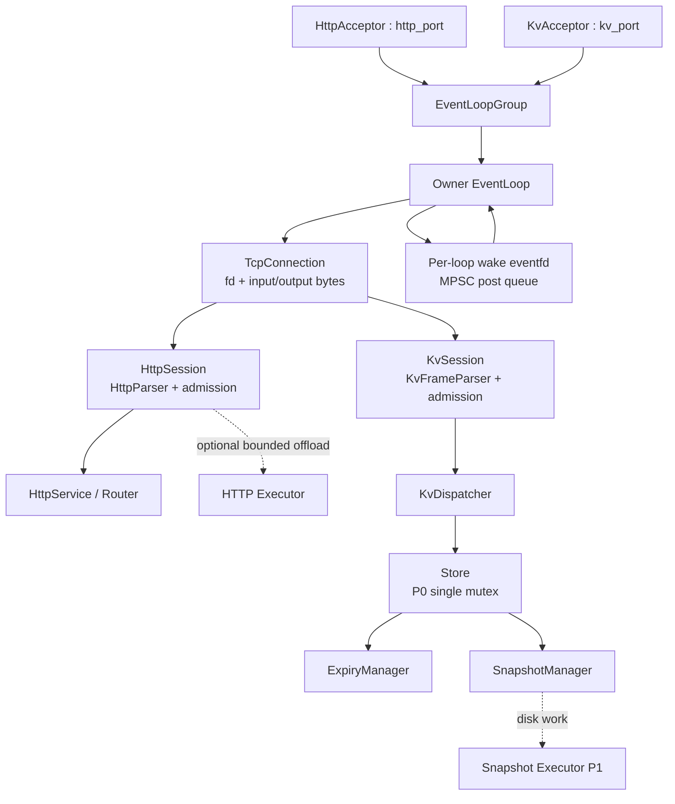

# MiniDB 项目实施计划书技术评审

评审对象：[MiniDB-实施计划书.md](./MiniDB-实施计划书.md)

评审范围：网络架构、资源生命周期、HTTP/KV 边界、并发存储、RDB、测试性能、工程化、阶段依赖和求职证据。

评审结论：计划书的学习目标和技术方向成立，已有的 LT epoll、owner loop、RDB 临时文件和故障测试思路是合理基础；但当前版本还不能直接进入多线程网络和业务协议实现。主要原因是若干“设计意图”尚未变成互相一致的状态机、所有权协议和可判定的测试语义。可以立即开始环境、RAII、Buffer 和单线程 Socket 实验；在下面的 P0 问题收敛前，不应开始 EventLoopGroup、异步业务任务、HTTP Keep-Alive 或 RDB 并发快照。

问题标签：

- **确定问题**：计划书内部已经存在矛盾，或缺少实现所必需的行为定义。
- **潜在风险**：设计方向可以成立，但当前描述不足以证明安全或正确。
- **待验证假设**：必须通过最小实验或基准决定，不能仅凭直觉定案。

## A. 必须修复的高风险问题

### A1. [P0，阻塞实施] 错误响应与立即关闭相互矛盾

计划书第 3.3 节称协议错误、超限、超时和业务关闭都进入 Closing，删除 epoll、关闭 fd；HTTP 测试和线程池规则又要求返回 400、408、413、503，KV 要返回 BUSY。若先关闭 fd，这些响应不会发给客户端。

**修改建议：**把连接状态改为至少：

```text
Accepted -> Reading -> Processing -> Writing
                         |             |
                         v             v
                    Draining/Error -> Closing -> Closed
```

定义两条不同路径：

- `failWithResponse`：停止读取、记录错误、将一个有上限的错误响应放入写缓冲，写完后关闭；
- `fatalClose`：RST、无法建立响应、资源已耗尽或协议状态不安全时直接从 epoll 删除并关闭。

明确 HUP、ERR、RDHUP、EOF、写 EPIPE 各自走哪条路径。阶段 C 必须用“错误响应确实到达”而不是只看进程未崩溃来验收。

### A2. [P0，阻塞实施] 只有全局有界队列，没有每连接背压

第 3.3 节规定每连接后续请求按序等待，第 D 阶段只限制全局 TaskExecutor 队列。恶意客户端可以在一个连接中持续发送完整请求，填满 owner loop 的 parser 缓冲和待处理请求列表；全局队列有界不能限制每连接内存。

同时，“队列满立即返回 503/BUSY”和“同连接请求按序返回”存在冲突：第 n 个请求不能越过尚未完成的第 n-1 个请求直接写回。

**修改建议：**P0 采用最简单可证明的策略：

- 每连接最多一个 in-flight 请求；
- parser 输入缓冲、请求体、输出缓冲和待完成请求都设字节上限；
- 有任务运行时暂时停止读取新请求，或只允许不超过上限的流水输入；
- P0 不支持 HTTP pipelining，Keep-Alive 只允许“响应完成后再读取下一个请求”；
- 队列拒绝时停止读取，必要时排队一个有序错误响应并 `Connection: close`，不要让错误响应越过旧请求；
- KV 使用相同的单连接顺序规则，协议文档写明 BUSY 后是否关闭连接。

如果之后要支持 pipelining，再引入请求序号、每连接有界队列和按序 completion，不要在 P0 同时解决。

### A3. [P0，阻塞实施] 跨线程请求和连接对象所有权没有落地

计划书使用“不可变请求”“弱引用/请求序号”描述异步完成，但没有规定 parser 产出的内存是否拥有。若请求或 body 是指向 TcpConnection Buffer 的 `string_view`，worker 执行期间 owner loop 可能 compact 或复用 Buffer，形成悬空引用或数据改变。

**修改建议：**

- 跨线程请求只传 owning 数据：`std::string`、拥有 body 的对象或明确生命周期的 arena；禁止跨线程保存 `string_view` 指向连接 Buffer；
- completion 不持有 `TcpConnection*`，也不通过 `shared_ptr<TcpConnection>` 延长 fd/缓冲生命周期；
- 使用 `ConnectionToken{id, generation, weak_state}`。owner loop 收到 completion 后验证连接仍存在、generation 和 request sequence 都匹配，才编码响应；失效结果直接丢弃；
- fd 交接期间由 Acceptor 暂时拥有。worker `post` 成功并完成 `epoll_ctl(ADD)` 后才转移所有权；任一步失败由当前 owner 关闭 fd；
- 对 Buffer compact、连接关闭、fd 重用和迟到 completion 做 ASan 回归测试。

### A4. [P0，阻塞实施] HTTP 和 KV 共用 Acceptor 的拓扑不明确

系统图中 HTTP 和 KV 都连接到同一个 Acceptor，但没有说明如何判断一个 TCP 连接属于哪种协议。不能可靠地先猜 HTTP 或 KV；错误猜测会把协议字节当作另一种协议解析。

**修改建议：**P0 使用两个明确监听端口和两个 Acceptor：例如 `HttpAcceptor` 和 `KvAcceptor`，它们共享 EventLoopGroup、TcpConnection、Buffer 和 Timer，但各自携带固定 `ProtocolFactory`。或者直接拆成两个进程。不要在一个监听端口上做协议猜测。README 和配置文件固定端口、绑定地址、backlog 和启动失败语义。

### A5. [P0，阻塞实施] 关停顺序和依赖对象销毁顺序不足

任务线程可能仍持有 Router、Store、配置或 RDB writer 的引用；如果先销毁业务对象再停止 TaskExecutor，会产生 UAF。计划书也没有把 Acceptor、worker loop、eventfd、扫描线程和任务线程放进一个完整 shutdown 协议。

**修改建议：**固定并测试以下顺序：

```text
停止接收新 signal
-> Acceptor 停止 accept 并关闭监听 fd
-> 各 EventLoop 停止读入新请求
-> 停止向 executor 提交任务
-> executor drain 或 cancel，join 所有任务线程
-> owner loop 处理或丢弃带 token 的 completion
-> 停止 expiry scanner，唤醒并 join
-> owner loop 删除 Channel、关闭连接 fd
-> 销毁 service/store/config
-> 关闭 eventfd、epoll fd 和线程
```

实际采用 drain 还是 cancel 必须写出：取消中的请求是否返回错误、已确认成功的写是否完成、RDB save 是否允许关停等待。增加 SIGTERM/SIGINT、重复 stop、worker 异常和任务抛异常测试。

### A6. [P0，必须收敛] KV 执行模型与流程图不一致

第 3.3 节说完整消息交给 TaskExecutor；KV 流程图却是 EventLoop 直接调用 Dispatcher 和 Store。两种模型的锁范围、请求顺序、响应回写和阻塞风险不同。

**修改建议：**P0 先选一个模型并写进架构决策：

- 推荐短 KV 命令在 owner loop 同步执行，Store 使用单 `std::mutex` 建立清晰线性化点；RDB 写盘和定期扫描另行处理；
- 若实验显示 Store 或大 value 会阻塞 loop，再引入 KV 专用 executor，要求独立的每连接 admission、owning request 和 token completion；
- HTTP 静态文件和 RDB 不要与 KV 命令共享一个无配额 executor，至少按服务或任务类型隔离队列。

在选择前，不要同时实现“EventLoop 直接 Store”和“所有命令异步化”。

### A7. [P0，必须冻结] HTTP 子集的关键语义还不可验收

“HTTP/1.1 风格”不足以指导实现。当前缺少 Host、版本、request-target、重复 Content-Length、Transfer-Encoding、Expect、Upgrade、连接 token 和错误响应后关闭策略的精确定义。

**修改建议：**在 `docs/protocol-http.md` 冻结支持矩阵，至少规定：

- 只支持 origin-form request-target；absolute-form、authority-form、asterisk-form 直接拒绝；
- 只支持 HTTP/1.1，HTTP/1.0 和其他版本返回 505 或按文档关闭；
- HTTP/1.1 要求恰好一个合法 Host；缺失或重复返回 400；
- header 名大小写不敏感；拒绝 obs-fold；限制 header 数、单行长度和总字节数；
- Content-Length 只允许十进制非负值；重复值必须一致；非法、溢出或不一致立即 400；
- 任意 Transfer-Encoding、Expect、Upgrade 在尚未等待 body 前就按“不支持”处理，避免慢客户端无限等待；
- 明确 GET 是否允许 body、是否实现 HEAD/OPTIONS、Connection token 大小写规则；
- 逐项规定 400/408/413/414/431/500/503/505 响应是否发送后关闭。

依据应以 [RFC 9110](https://www.rfc-editor.org/rfc/rfc9110) 和 [RFC 9112](https://www.rfc-editor.org/rfc/rfc9112) 为准，而不是只根据 curl 行为决定。

### A8. [P0/P1] 静态文件的安全边界被低估

canonical path 后再单独 open 存在 symlink 和 TOCTOU 风险。静态文件也会把权限、目录、文件大小、符号链接、文件变化和磁盘错误引入 P0 网络阶段。

**修改建议：**推荐把静态文件移到 P1，P0 只实现内存 GET/POST。若坚持 P0，必须定义 root 目录 fd，使用 `openat` 配合 `O_NOFOLLOW|O_CLOEXEC|O_RDONLY`，随后 `fstat` 检查普通文件、大小和权限，并测试 symlink、替换文件、目录、NUL/反斜杠和 percent-decoding 后的 `..`。

## B. 潜在的并发、资源管理和数据一致性问题

### B1. epoll 事件和半关闭处理不完整

`EPOLLHUP` 不应简单等价于“立刻丢弃全部数据”；可能仍有可读数据。`EPOLLERR` 应读取 `SO_ERROR` 辅助定位；`EPOLLRDHUP`、`read()==0`、RST 和写 EPIPE 要分别记录策略。事件处理通常应先处理错误/关闭标志的语义，再按设计决定是否 drain 可读数据和已排队响应。

阶段 C 增加：HUP+剩余数据、RDHUP、RST、写 EPIPE、EOF 后响应 drain 的测试。通过 `MSG_NOSIGNAL` 或进程级忽略 SIGPIPE，防止对端关闭后 write 终止进程；这应是 P0。

参考：[epoll(7)](https://man7.org/linux/man-pages/man7/epoll.7.html)、[socket(7)](https://man7.org/linux/man-pages/man7/socket.7.html) 和 [signal(7)](https://man7.org/linux/man-pages/man7/signal.7.html)。

### B2. EventLoop 唤醒机制和 post 队列需要精确定义

图中只有一个 eventfd，但没有说明它属于哪个 loop。建议每个 EventLoop 持有独立的 `eventfd(EFD_NONBLOCK|EFD_CLOEXEC)` 和 MPSC post/completion queue。生产者先入队再写 eventfd；loop 被唤醒后反复读空 eventfd，再 drain 队列。要规定 eventfd 写入 `EAGAIN`、重复 post、loop 已停止和队列关闭时的行为。

### B3. Timer 回调可能误杀 fd 重用后的新连接

连接 idle timer 只写了“取消定时器”，没有 token/generation。旧 timer 回调若在 fd 复用后执行，可能关闭新连接。

**修改建议：**timer 回调携带 connection generation 或 weak token，在 owner loop 重新验证；区分 header/body idle、keep-alive idle、write stall 和业务执行超时，P0 至少先实现一种 idle timeout 并测试 fd 重用。

### B4. accept、epoll_ctl 和资源耗尽路径缺测试

必须处理 accept 循环直到 EAGAIN、EINTR、EMFILE/ENFILE、`epoll_ctl` 失败、eventfd 创建失败、线程创建失败、`SO_REUSEADDR`、`CLOEXEC`、backlog 和 `RLIMIT_NOFILE`。Acceptor 无法把新 fd 交给 worker 时必须由当前 owner 关闭，不能泄漏。

增加资源耗尽故障注入：服务继续监听、拒绝新连接并保持已有连接，或按文档安全降级。阶段 B/C 还应明确忽略 SIGPIPE 或使用 `MSG_NOSIGNAL`。

### B5. P0 锁策略前后矛盾

范围表把 `unordered_map + shared_mutex` 列为 P0，但第 4.6 节和阶段 F 又要求先单 mutex，再替换/补充 shared_mutex。应把 P0 固定为单 `std::mutex`；所有命令、惰性删除和扫描都在同一锁协议下建立线性化点。`shared_mutex` 作为 P1 对照实验，不作为 P0 正确性的前置假设。

### B6. shared_mutex 下惰性删除存在 ABA 风险

未来若 GET 在共享锁下发现 key 过期，释放共享锁后升级为独占锁删除；期间另一个线程可能 SET 同名新值，旧请求再按 key 删除就会误删新值。

**修改建议：**P0 用单 mutex；P1 若采用 shared_mutex，升级删除时必须在独占锁下重新查找并校验 deadline 或 Entry generation，只有仍是同一过期 Entry 才 erase。

### B7. TTL 语义缺少可判定定义

必须先规定：SET 覆盖旧值是否清除 TTL；EXPIRE 对不存在、已过期 key、0 和负值的返回；重复 EXPIRE；TTL 向下、向上还是截断；DEL 后 TTL；过期键在 GET/TTL/EXPIRE 中何时原子删除。当前只有 `missing=-2` 和 `persistent=-1`，不足以写出确定测试。

**修改建议：**建立表驱动协议测试，并使用 fake clock 覆盖 deadline 前、恰好到期、deadline 后、SET 覆盖和 EXPIRE/DEL 交错。运行时选择一种时钟规则：若用 realtime deadline，明确系统时间回拨/跳跃行为；恢复时以绝对 Unix ms 重算，已过期记录直接丢弃。

### B8. Expiry scanner 生命周期和迭代规则不足

扫描线程必须和命令共享同一个 Store 锁；扫描期间不能无锁遍历 `unordered_map`，也不能在可能 rehash 时持有失效迭代器。关停顺序应是停止标志、唤醒、join，再销毁 Store。用 fake clock 和 barrier 测试 scanner 与 GET/SET/DEL/EXPIRE 同 key 的交错；TSan 只能发现数据竞争，不能证明 TTL 语义正确。

### B9. RDB 快照线性化点没有定义

阶段 G 写了“停顿服务快照”，但没有规定先停止 accept、停止写请求、排空 in-flight mutation 还是直接持锁序列化。第 3.3 节又允许任务已投递到 executor。普通 SET→snapshot→restart 测试不能证明并发语义。

**修改建议：**P0 采用明确的 stop-the-world 语义：进入 SAVE barrier，停止接收新写请求，等待已接受的写命令完成，在确定的 snapshot point 下冻结 Store，序列化和落盘期间新写请求排队或返回 BUSY，完成后恢复。测试一个 marker key 和并发 writer，证明“已确认成功的写一定在快照内，尚未线性化的写不作承诺”。P1 再做复制一致性视图和解锁写盘。

### B10. RDB 格式和保存并发缺少边界

格式需要规定最大文件、记录数、key/value 长度、总长度溢出检查、空 key/value、重复 key、尾随字节、checksum 覆盖的精确字节范围和版本兼容策略。恢复前完整读入临时 map 时也要有内存上限。

保存操作必须串行化或带 generation；否则两个 save 可交错或旧快照最后 rename 覆盖新快照。测试 write-all 短写、EINTR、ENOSPC、close/fsync/rename/父目录 fsync 每个失败点，以及 kill -9 发生在这些阶段后的重启选择。

文件不存在和文件损坏必须分开：文件不存在可按配置启动空库；checksum/长度/版本损坏默认启动失败或进入明确的只读恢复模式，不能静默当空库并在下一次退出时覆盖有效数据。checksum 能发现随机损坏，但不是防恶意修改的认证机制。

## C. 需要进一步验证的设计假设

1. **WSL2 工具能力。** 逐项 smoke test `eventfd`、ASan/UBSan、TSan、perf、strace 和 gdb。WSL 中不可用的工具由 Ubuntu CI 或远程 Linux 补测，不能把“安装成功”当作能力通过。
2. **多 worker 是否值得 P0。** 先比较单 EventLoop 和多 worker 的功能复杂度、尾延迟和 CPU 利用率。若没有可重复收益，将多 worker/TaskExecutor 降为 P1；P0 仍可证明核心 Reactor。
3. **是否需要 pipelining。** 若项目目标只要求 Keep-Alive，可 P0 明确不支持 pipelining；不要为覆盖一个术语引入请求序列和复杂取消逻辑。
4. **KV 同步命令是否阻塞 loop。** 用大 value、锁竞争和多客户端基准测量；只有证明阻塞才引入 KV 专用 executor。
5. **P0 停顿快照的可接受停顿。** 先测快照大小、写盘速度和请求排队时间，再决定复制视图是否有必要；不要先实现 COW 或 WAL。
6. **静态文件安全实现。** 如果无法在 WSL 中稳定验证 `openat`/`O_NOFOLLOW`、权限和 TOCTOU，静态文件保持 P1。
7. **性能基准是否被客户端限制。** 明确 closed-loop 或 open-loop 负载；固定客户端版本、随机种子、monotonic clock、百分位实现和原始样本。记录客户端 CPU/RSS；必要时让 client/server 分离或用多个压测进程，确认瓶颈不在客户端。
8. **HTTP 错误码和关闭行为。** 用自写客户端逐项验证 RFC 9110/9112 规定的 Host、Content-Length、Transfer-Encoding、Expect 和连接管理边界，不能只以 curl 成功为准。

## D. 应删除、推迟或简化的功能

1. **静态文件从 P0 移到 P1。** P0 保留内存 GET/POST、增量 parser、Keep-Alive、限额和错误响应；静态文件在安全打开和 TOCTOU 测试完成后再加入。
2. **P0 不支持 HTTP pipelining。** Keep-Alive 仍可支持，但一个连接一次只处理一个请求；在协议支持矩阵中明确声明。
3. **P0 使用单 `std::mutex`。** `shared_mutex` 作为 P1 性能对照，不要让锁优化和基础正确性同时变化。
4. **P0 使用停顿快照。** 复制视图、异步写盘、COW、WAL、增量日志都推迟到有停顿数据和一致性模型后。
5. **ET、EPOLLONESHOT、io_uring、协程、零拷贝、分片锁、LRU 和压缩保持 P2。** 当前计划已经大体如此，应确保实现阶段不会提前引入。
6. **开源贡献不应阻塞 MiniDB 核心完成。** 核心验收要求公开记录 issue/PR 尝试和可复现测试；维护者是否合并属于独立加分项，不应成为本项目准入条件。
7. **不要在核心代码维护第二套 Windows Reactor。** Windows 可运行纯 C++ 模块测试；Linux 网络目标统一在 WSL2/CI/远程 Linux 验收。

## E. 修改后的架构和模块边界建议

建议把当前 `TcpConnection -> HttpParser/KvParser` 的图示改成“网络层提供字节事件，Session 层拥有协议解析器”：



边界和所有权建议：

| 对象/操作 | 唯一 owner | 允许其他线程做什么 | 关闭/失败处理 |
|---|---|---|---|
| listen fd | 对应 Acceptor loop | 只通过配置读取状态 | stop accept 后 owner 关闭 |
| connection fd、Channel、input/output Buffer | connection owner EventLoop | post 不可变请求或 completion，不直接访问 fd | owner 删除 epoll、关闭 fd、递增 generation |
| epoll interest list | 创建该 epoll 的 EventLoop | 其他线程只能 post `ADD/MOD/DEL` 请求 | `epoll_ctl` 失败由 owner 记录并进入关闭策略 |
| parser 和 Session | connection owner EventLoop | 不跨线程共享 parser/view | 错误响应走 Draining，致命错误走 fatalClose |
| request/body | 创建任务的线程直到 completion | executor 只持有 owning 数据 | connection token 失效时丢弃结果 |
| Store | Store 自身 | P0 命令通过明确锁协议访问 | scanner stop/join 后销毁 |
| TaskExecutor | executor 管理线程 | owner loop 提交不可变任务 | stop 后拒绝新任务，drain/cancel 有明确语义 |
| eventfd/post queue | 每个 EventLoop | producer 入队并唤醒 | loop 停止后拒绝 post 或安全丢弃 tokenized completion |

网络层职责：accept、非阻塞 read/write、EINTR/EAGAIN、epoll、Timer、连接状态和输出队列。Session/协议层职责：HTTP/KV 字节边界、请求限额、协议错误和请求序号。Service 层职责：路由和命令语义。Storage 层职责：线性化、TTL、快照和恢复。HTTP/KV 共享网络组件，但使用不同 listener、Session、协议错误码和 Service；不共享 parser 或业务状态。

## F. 修改后的分阶段开发路线

### 阶段 A：环境和可移植工程基线

**前置条件：**Windows 上确认 WSL2 可用；在 WSL Linux 文件系统建立唯一工作树；验证 C++20、CMake、CTest、Git、ASan/UBSan，记录 TSan/perf 能力限制。

**交付成果：**CMake Presets、目录骨架、`.clang-format`、compile_commands、UniqueFd、Buffer、Status/Error、Clock、基础日志、GoogleTest/CTest 和 README 构建说明。

**验收门槛：**干净 WSL 目录可构建；RAII/Buffer/Clock 测试全绿；ASan/UBSan smoke 通过；无未解释 fd 泄漏；原生 Windows 测试只能作为纯模块补充。

### 阶段 B：系统调用最小实验

**前置条件：**阶段 A 通过。

**交付成果：**blocking/non-blocking Echo、`EINTR/EAGAIN`、短读短写、EOF、RST、半关闭、`SO_REUSEADDR`、`CLOEXEC`、backlog、SIGPIPE 处理实验；保存 strace 和 fd 计数。

**验收门槛：**能稳定制造部分读写、EAGAIN 和对端关闭；写 EPIPE 不终止进程；accept 循环到 EAGAIN；资源异常有明确结果。

### 阶段 C：单 EventLoop 和连接生命周期

**前置条件：**阶段 B 通过；先冻结 ownership/close 协议。

**交付成果：**EpollPoller、Channel、单线程 EventLoop、Acceptor、TcpConnection、读写 Buffer、LT Echo、Timer generation、Draining/Closing 状态机。

**验收门槛：**只由 owner loop 修改 epoll 和 fd；读写循环到 EAGAIN；HUP/ERR/RDHUP/EOF/RST/EPIPE 处理可解释；错误响应能发送或明确 fatalClose；fd 重用、迟到 timer、重复 close、SIGTERM 通过 ASan/UBSan。

### 阶段 D1：多 EventLoop 的 fd 交接

**前置条件：**阶段 C 通过；不引入业务线程池。

**交付成果：**Acceptor round-robin、每 worker 独立 epoll、owner-loop transfer、每 loop nonblocking CLOEXEC eventfd 和 MPSC post queue。

**验收门槛：**accept fd 交接失败安全关闭；无跨线程 epoll_ctl/fd 访问；post/唤醒/loop stop 竞态可复现；多连接 Echo 和 shutdown 通过 TSan/ASan。

### 阶段 D2：最小异步任务和背压

**前置条件：**D1 通过。

**交付成果：**有界 executor、一个 offload Echo 或固定 CPU 任务、owning request、ConnectionToken、completion 顺序、队列满策略和完整 shutdown。

**验收门槛：**每连接 in-flight/byte 上限有效；队列满不无限占内存、不越过旧响应；worker 异常被捕获，任务不重复执行；关闭后迟到 completion 安全丢弃；executor join 后才销毁被引用对象。

### 阶段 E：协议 Session 和 HTTP 子集

**前置条件：**D2 通过；先提交 HTTP 支持矩阵。

**交付成果：**HttpSession、增量 request-line/header/body parser、响应 encoder、内存 GET/POST、Keep-Alive 串行请求、400/408/413/431/500/503/505 行为表。

**验收门槛：**逐字节、粘包、拆包、非法/重复 Content-Length、Host、TE/Expect/Upgrade、慢 body、慢读端、错误响应 drain、超时和并发快客户端测试通过；P0 明确不支持 pipelining、chunked、TLS、Range、静态文件。

### 阶段 F：KV Session、Store 和 TTL

**前置条件：**阶段 E 的 Session/背压模型通过；协议帧格式和 TTL 语义已冻结。

**交付成果：**KvSession、长度前缀 parser、SET/GET/DEL/PING/EXPIRE/TTL、P0 单 mutex、fake clock、惰性删除和可停止 scanner。

**验收门槛：**表驱动 TTL 语义全绿；同 key 的 GET/SET/DEL/EXPIRE/scanner 交错有线性化测试；scanner 迭代安全且能停止；固定 seed 的 model-based stress + TSan 无数据竞争、死锁和活锁。

### 阶段 G：RDB P0 停顿快照和恢复

**前置条件：**阶段 F 通过；先冻结 RDB 格式、大小上限和损坏策略。

**交付成果：**magic/version/count/长度/expiry/checksum 格式、全量校验、临时文件、write-all、文件 fsync、rename、父目录 fsync、串行 save、启动恢复和故障注入。

**验收门槛：**明确 snapshot barrier；已确认写入的包含规则可证明；截断、尾随、超限、重复 key、checksum/version 错、短写/EINTR/ENOSPC/close/fsync/rename/dir-fsync 失败和 kill -9 重启测试通过；损坏文件不静默当空库。

### 阶段 H：P1 优化、集成和公开交付

**前置条件：**A-G 的 P0 证据完整。

**交付成果：**基于数据的 shared_mutex/复制快照/异步 RDB/静态文件/ET 对照；持续 CI、CTest labels/resource locks、fuzz target、clang-tidy/cppcheck、可复现性能报告、README、Docker 演示和开源贡献记录。

**验收门槛：**优化前后可比较；性能报告记录 WSL 环境、client/server 资源、负载模型、种子、原始样本和限制；CI 版本固定；开源 issue/PR 不阻塞 MiniDB 核心完成。

## G. 最终验收清单

### 网络和资源

- [ ] 每个服务有独立 listener/端口和 ProtocolFactory。
- [ ] Acceptor、EventLoop、Channel、connection fd、epoll interest 和 close 的唯一 owner 有文档和测试。
- [ ] accept/read/write 都能处理 EINTR、部分进展和 EAGAIN；accept 到 EAGAIN。
- [ ] HUP、ERR、RDHUP、EOF、RST、EPIPE、SIGPIPE 有确定处理策略。
- [ ] Draining、fatalClose、超时、fd generation 和 timer generation 已测试。
- [ ] 每连接 parser/request/output 有字节上限；P0 不允许无界 pipelining。
- [ ] 跨线程只传 owning 数据和 tokenized completion，不传 raw connection pointer 或 Buffer view。
- [ ] SIGTERM/SIGINT、重复 stop、任务异常、队列满和资源耗尽可安全退出或降级。

### HTTP 和 KV

- [ ] HTTP 支持矩阵冻结并逐项测试 Host、版本、request-target、Content-Length、TE/Expect/Upgrade、header 限额和关闭语义。
- [ ] HTTP P0 的 GET/POST、Keep-Alive、超时、错误响应、慢客户端和并发快客户端通过。
- [ ] KV 帧长度、最大值、粘包拆包、未知 opcode 和错误响应通过。
- [ ] TTL 的 SET/EXPIRE/DEL/TTL/GET 语义由 fake clock 表驱动测试锁定。
- [ ] Store P0 单 mutex 的锁范围、线性化点和 scanner shutdown 已证明。

### RDB 和恢复

- [ ] 快照 barrier、已确认写入的包含规则和停顿/排队语义明确。
- [ ] RDB 所有长度、数量、文件大小和分配均有上限与溢出检查。
- [ ] write-all、EINTR、短写、ENOSPC、close/fsync/rename/dir-fsync 故障可注入。
- [ ] 并发 save 串行化，旧/新快照不会因完成顺序倒置。
- [ ] 截断、尾随、checksum/version 错、重复 key、bit flip 和 kill -9 恢复测试通过。
- [ ] 文件缺失与损坏采用不同策略；恢复失败不会发布部分 Store。

### 测试、性能和工程化

- [ ] CTest 具有临时目录、动态端口、readiness、进程组清理、超时和资源锁，失败不假绿。
- [ ] ASan/UBSan/TSan 分开运行；固定 seed 的并发 stress、watchdog 和 model-based Store 测试通过。
- [ ] parser 有 ASan fuzz target、固定 corpus 和崩溃样本回归。
- [ ] CI 的 runner、action、编译器和依赖版本可追踪；格式/静态分析有门禁。
- [ ] 性能测试明确 open/closed-loop、客户端瓶颈识别、monotonic clock、百分位算法、重复轮次和原始样本。
- [ ] 所有性能结果标注 WSL2，不宣称裸机 Linux 性能；未测数据仍为占位符。
- [ ] README、协议矩阵、架构图、故障复现、设计决策和复盘与实际实现一致。

## H. 是否建议开始实施

**建议开始，但只从阶段 A 和 B 开始。** 当前没有理由等待所有 P1 设计；RAII、Buffer、Clock、CMake、GoogleTest、blocking/non-blocking Echo 和 syscall trace 可以立即实施。

开始阶段 C 前必须解决：

1. Draining/fatalClose 状态机以及错误响应发送规则；
2. 单服务独立 listener/端口拓扑；
3. 每连接 admission、请求/响应字节上限和 P0 不支持 pipelining 的决定；
4. connection token、owning request、fd/timer generation 和每 loop eventfd/post queue；
5. server shutdown 顺序、accept fd 交接和 executor/Store/扫描线程销毁顺序。

开始阶段 E 前必须冻结 HTTP 支持矩阵；开始阶段 F 前必须冻结 TTL 表驱动语义和 KV 执行模型；开始阶段 G 前必须冻结 snapshot barrier、RDB 格式上限和损坏恢复策略。

## 参考依据

- Linux man-pages：[epoll(7)](https://man7.org/linux/man-pages/man7/epoll.7.html)、[eventfd(2)](https://man7.org/linux/man-pages/man2/eventfd.2.html)、[accept4(2)](https://man7.org/linux/man-pages/man2/accept4.2.html)、[openat(2)](https://man7.org/linux/man-pages/man2/openat.2.html)、[fsync(2)](https://man7.org/linux/man-pages/man2/fsync.2.html)、[rename(2)](https://man7.org/linux/man-pages/man2/rename.2.html)、[signal(7)](https://man7.org/linux/man-pages/man7/signal.7.html)。
- HTTP 语义和消息语法：[RFC 9110](https://www.rfc-editor.org/rfc/rfc9110)、[RFC 9112](https://www.rfc-editor.org/rfc/rfc9112)。
- C++ 并发和资源行为应以所选编译器支持的 C++20 标准、标准库文档和 sanitizer 实际版本为准；工具是否可用必须通过本机 smoke test 记录。

